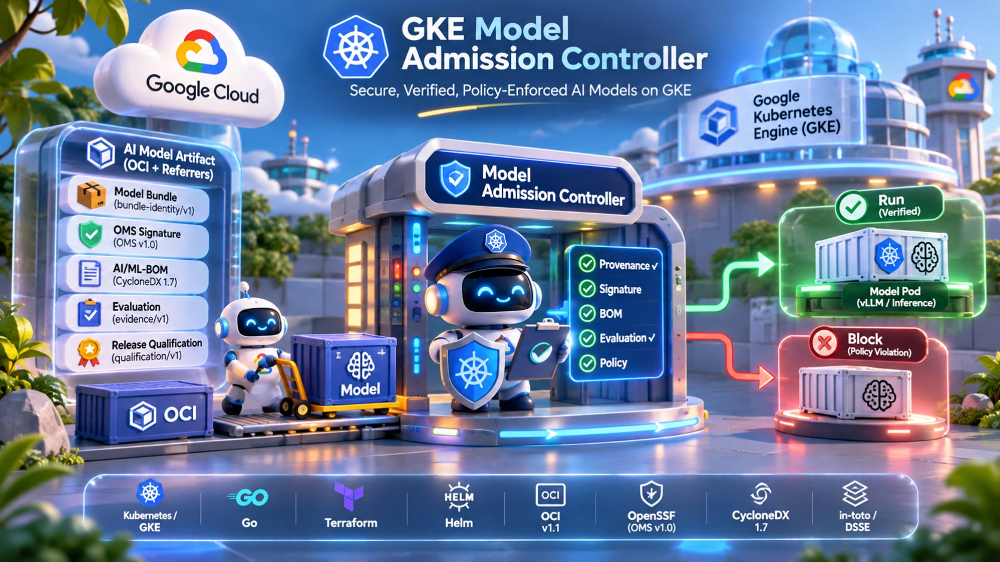
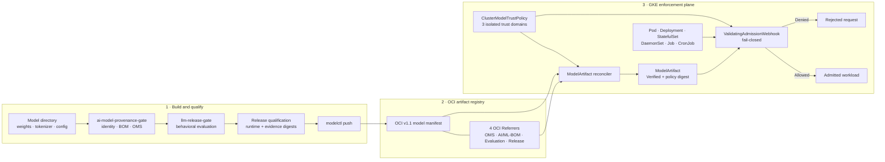

<div align="center">

# GKE Model Admission Controller

### Verify the model, not just the container.

**Cryptographic provenance · Behavioral qualification · Fail-closed Kubernetes admission**

Admission control for AI models and LoRA adapters running on **Google Kubernetes Engine (GKE)**. Verify model identity, signed evidence, release qualification, and the serving runtime before an AI workload is admitted.

[](https://github.com/devenes/gke-model-admission-controller/actions/workflows/ci.yml)
[](go.mod)
[](docs/guides/gke-deployment.md)
[](terraform/)
[](charts/model-admission-controller/)
[](docs/adr/ADR-002-oci-model-artifact.md)
[](docs/concepts/ai-ml-bom.md)
[](docs/concepts/model-signing.md)
[](docs/concepts/in-toto-attestations.md)
[](LICENSE)

[Architecture](docs/architecture/overview.md) · [Quick Start](docs/QUICKSTART.md) · [GKE Deployment](docs/guides/gke-deployment.md) · [Security Model](docs/security/threat-model.md) · [Tutorials](docs/tutorials/01-understanding-ai-model-admission.md) · [Operations](docs/operations/day-two-operations.md)

</div>

<div align="center">
  
</div>

---

## The problem

A signed and scanned inference container does not prove that the **model loaded by that container** is trustworthy.

On GKE, model weights, tokenizers, configuration files, chat templates, and LoRA adapters can be delivered separately from the serving image. A workload can therefore use a trusted runtime while loading an altered, unqualified, or incorrectly paired model artifact.

This project adds a model-aware trust layer to Kubernetes admission. It verifies the model supply chain and binds the resulting evidence to the exact serving runtime and configuration.

## What it enforces

| Control | What is verified |
|---|---|
| **Model identity** | Deterministic `bundle-identity/v1` identity and file inventory using RFC 8785 JCS |
| **Model signing** | OpenSSF Model Signing (`OMS v1.0`) and an isolated model-signer trust domain |
| **AI/ML bill of materials** | CycloneDX 1.7 AI/ML-BOM, model card, and per-file SHA-256 inventory |
| **Behavioral qualification** | Native `llm-release-gate` evaluation evidence, including suite and dataset digests |
| **Release authorization** | Signed `release-qualification/v1` binding the evidence, runtime image digest, and serving configuration digest |
| **LoRA lineage** | Adapter provenance and `baseModelBundleId` linkage to a currently verified base model |
| **Kubernetes admission** | Fail-closed decisions for protected workloads, with unauthorized exemptions rejected |

### Key properties

- **No model-weight download during controller verification.** The controller verifies OCI descriptors and evidence artifacts without pulling multi-gigabyte `.safetensors` blobs into its pod.
- **Three isolated trust domains.** Model signers, trusted evaluators, and release authorities use separate keys; cross-domain key reuse is rejected.
- **Evidence is bound together.** The release qualification pins the digests of the model manifest, BOM, model signature, evaluation report, evaluation attestation, runtime image, and serving configuration.
- **Runtime images are immutable.** Protected workloads must use an image reference pinned by `@sha256:`.
- **Unsafe model loading patterns are rejected.** The verifier detects `.pkl` / `.pt` pickle payloads and `auto_map` remote-code hooks.
- **Six workload kinds are covered.** `Pod`, `Deployment`, `StatefulSet`, `DaemonSet`, `Job`, and `CronJob` are checked in protected namespaces.

> **Verification boundary:** the controller does not download model-weight blobs while reconciling an OCI artifact. The inference worker still needs to retrieve the model. To verify the bytes served to that worker, pair admission with a node-side init-container or CSI fetcher that checks each file against `bundle-manifest.json`.

## Architecture

The system has three stages: **build and qualify the model**, **publish its evidence**, then **verify and enforce policy on GKE**.



### The two verification stages

**1. Background artifact verification** — `ModelArtifactReconciler` reads the OCI manifest, descriptors, config blob, and four referrer artifacts. It verifies the evidence and records `status.phase = Verified`, together with the evaluated policy digest. It does not download the model-weight layers.

**2. Synchronous workload admission** — when Kubernetes receives a protected workload request, the `ValidatingAdmissionWebhook` checks the referenced `ModelArtifact`, its freshness and policy binding, LoRA parent health, runtime image digest, serving configuration digest, and exemption authorization. A failed check is denied.

### The three-repository supply chain

This repository is the Kubernetes enforcement plane in a three-project workflow.

| Repository | Responsibility |
|---|---|
| [`llm-release-gate`](https://github.com/devenes/llm-release-gate) | Runs model evaluation suites and emits signed `evaluation-evidence/v1` DSSE attestations. |
| [`ai-model-provenance-gate`](https://github.com/devenes/ai-model-provenance-gate) | Creates deterministic model identities, CycloneDX AI/ML-BOMs, OMS signatures, release qualifications, and the verification library. |
| **`gke-model-admission-controller`** | Packages model bundles with `modelctl`, reconciles `ModelArtifact` and `ClusterModelTrustPolicy`, and enforces admission on GKE. |

<details>
<summary><strong>View the complete 10-step trust flow</strong></summary>

1. `ai-model-provenance inspect` inventories model files, checks for prohibited pickle and remote-code patterns, and computes `bundle_id` and `manifest_digest` using RFC 8785 JCS.
2. `ai-model-provenance bom generate` creates the CycloneDX 1.7 AI/ML-BOM with model metadata and per-file SHA-256 hashes.
3. `ai-model-provenance oms sign` signs the file inventory and OMS root digest with the model-signer key.
4. `llm-release-gate run` evaluates the model and emits a native `evaluation-evidence/v1` DSSE attestation using the trusted-evaluator key.
5. `ai-model-provenance gate evaluate` verifies the preceding evidence, binds the serving image digest and serving configuration digest, and issues `release-qualification/v1` using the release-authority key.
6. `modelctl push` publishes model files as OCI layers, `bundle-manifest.json` as the OCI config blob, and four evidence artifacts as OCI v1.1 Referrers in Google Artifact Registry.
7. `ClusterModelTrustPolicyReconciler` validates the public keys for all three trust domains and computes `status.policyDigest`.
8. `ModelArtifactReconciler` fetches OCI metadata and evidence, performs the verification pipeline without downloading model weights, and marks the artifact `Verified`.
9. The admission webhook checks artifact status, generation, policy digest, validity, LoRA lineage, runtime image pinning, and serving configuration before allowing a workload.
10. Changes to trust policy keys or a parent base model invalidate stale bindings and trigger dependent resources to be reconciled again.

</details>

### Detailed architecture diagrams

- [Three-domain digest model](docs/architecture/digest-model.md)
- [OCI model bundle and four-referrer layout](docs/concepts/oci-model-bundles.md)
- [Synchronous admission sequence](docs/architecture/admission-flow.md)
- [LoRA compositional trust](docs/concepts/lora-composition.md)

## Security in action

### Approved workload

A workload referencing a `Verified` `ModelArtifact` and using the attested runtime image digest and serving configuration can be admitted:

```bash
kubectl apply -f examples/positive-deployment.yaml
```

### Rejected workload

A model-serving workload in an enforced namespace without a model-artifact reference is denied:

```bash
kubectl apply -f examples/negative-unannotated-vllm.yaml
```

Expected policy reason:

```text
[MISSING_MODEL_ARTIFACT_REF]
```

<details>
<summary><strong>More negative security scenarios</strong></summary>

| Scenario | Expected denial |
|---|---|
| Mutable runtime image tag such as `:latest` | `RUNTIME_IMAGE_NOT_DIGEST_PINNED` |
| Unauthorized self-assigned exemption | `UNAUTHORIZED_EXEMPTION` |
| Model bundle contents do not match the declared identity | `BUNDLE_ID_MISMATCH` |
| Unsafe pickle payload or remote-code hook | `UNSAFE_PICKLE_DETECTED` / `REMOTE_CODE_HOOKS_DETECTED` |
| LoRA adapter references an unverified or mismatched base model | `BASE_MODEL_UNVERIFIED` / `LORA_BASE_MISMATCH` |

See the [threat model and adversarial test matrix](docs/security/threat-model.md) for the complete set of scenarios.

</details>

## Quick start

### Local verification — no cloud credentials

Build the binaries, run the test suite, and validate the Helm and Terraform configuration locally:

```bash
# Build controller, modelctl, and gke-e2e
make build

# Run unit, pipeline, OCI, and adversarial security tests
go test -race -v ./...

# Validate deployment and infrastructure definitions
helm lint ./charts/model-admission-controller
terraform -chdir=terraform fmt -check -recursive
```

For the complete local workflow using synthetic model fixtures, follow the **[5-minute Quick Start](docs/QUICKSTART.md)**.

### Deploy to GKE

1. **Configure Terraform variables.**

   ```bash
   cp terraform/environments/demo/terraform.tfvars.example \
      terraform/environments/demo/terraform.tfvars
   # Set project_id and any environment-specific values.
   ```

2. **Provision GKE and Artifact Registry.**

   ```bash
   terraform -chdir=terraform init
   terraform -chdir=terraform apply \
     -var-file=environments/demo/terraform.tfvars
   ```

3. **Install cert-manager and the controller.** Follow the [GKE deployment guide](docs/guides/gke-deployment.md) for certificate setup, image publishing, and Helm installation.

4. **Run the live GKE end-to-end suite.**

   ```bash
   ./bin/gke-e2e \
     --registry "${REGION}-docker.pkg.dev" \
     --repo-prefix "${PROJECT_ID}/models"
   ```

The repository documents 42 live GKE scenarios: 10 positive, 28 adversarial negative, and 4 high-availability resilience scenarios.

## Technology stack

| Area | Technology |
|---|---|
| Language and runtime | Go; distroless non-root controller image |
| Kubernetes controller | `controller-runtime` `v0.20.2`; `client-go` `v0.32.2` |
| OCI registry | `google/go-containerregistry` `v0.20.3`; OCI Image and Distribution Specification v1.1 |
| Model provenance | `bundle-identity/v1`, OpenSSF Model Signing v1.0, CycloneDX 1.7, RFC 8785 JCS |
| Evaluation and attestations | `llm-release-gate`; in-toto Statement v1 / DSSE |
| Cloud platform | Google Kubernetes Engine Standard; Workload Identity |
| Infrastructure as code | Terraform `>= 1.6.0`; Google provider `~> 6.0` |
| Packaging and certificates | Helm `3.14+`; cert-manager `v1.17.1` |
| Observability | Prometheus metrics and Google Cloud Monitoring dashboard; 11 custom metrics |

## Documentation

Choose a starting point based on your role.

| Audience | Start here |
|---|---|
| **Platform and GKE engineers** | [GKE deployment](docs/guides/gke-deployment.md) · [Terraform](docs/guides/terraform-guide.md) · [Helm installation](docs/guides/helm-installation.md) · [Monitoring](docs/guides/monitoring.md) · [Day-two operations](docs/operations/day-two-operations.md) |
| **Security architects and auditors** | [Threat model](docs/security/threat-model.md) · [Security guarantees](docs/SECURITY_GUARANTEES.md) · [Trust domains](docs/concepts/trust-domains.md) · [Audit mode and exemptions](docs/guides/audit-mode.md) · [Limitations](docs/LIMITATIONS.md) |
| **ML and release engineers** | [Quick Start](docs/QUICKSTART.md) · [CLI reference](docs/COMMAND_REFERENCE.md) · [Artifact Registry](docs/guides/artifact-registry.md) · [LoRA composition](docs/concepts/lora-composition.md) · [Troubleshooting](docs/guides/troubleshooting.md) |
| **Contributors** | [Architecture](docs/architecture/overview.md) · [Local development](docs/guides/local-development.md) · [ADRs](docs/adr/) · [Contributing](CONTRIBUTING.md) |

### 13-part hands-on tutorial

The tutorial series takes a model from local files through signing, evaluation, OCI publishing, GKE installation, and adversarial admission tests.

<details>
<summary><strong>Show all 13 tutorials</strong></summary>

1. [Understanding AI model supply-chain admission control](docs/tutorials/01-understanding-ai-model-admission.md)
2. [Creating a deterministic model bundle](docs/tutorials/02-creating-a-model-bundle.md)
3. [Generating a CycloneDX AI/ML-BOM](docs/tutorials/03-generating-ai-ml-bom.md)
4. [Signing model artifacts with OpenSSF Model Signing](docs/tutorials/04-signing-model-artifacts.md)
5. [Running behavioral evaluation with `llm-release-gate`](docs/tutorials/05-running-llm-release-gate-evaluation.md)
6. [Creating the release qualification attestation](docs/tutorials/06-creating-release-qualification-attestation.md)
7. [Publishing to Artifact Registry with `modelctl`](docs/tutorials/07-publishing-to-artifact-registry.md)
8. [Provisioning GKE and Artifact Registry with Terraform](docs/tutorials/08-provisioning-gke-with-terraform.md)
9. [Installing cert-manager and the admission controller](docs/tutorials/09-installing-the-admission-controller.md)
10. [Configuring `ClusterModelTrustPolicy`](docs/tutorials/10-configuring-cluster-model-trust-policy.md)
11. [Registering and verifying a `ModelArtifact`](docs/tutorials/11-registering-a-modelartifact.md)
12. [Deploying an approved model workload](docs/tutorials/12-deploying-an-approved-model-workload.md)
13. [Testing adversarial security failures](docs/tutorials/13-testing-security-failures.md)

</details>

For the full documentation catalogue, see the [documentation index](docs/README.md).

## Limitations and security boundaries

This controller is an admission-time trust control. It complements, rather than replaces, runtime and node-level security controls.

1. **Model bytes after admission:** the controller verifies OCI metadata and evidence without downloading model-weight blobs. Use an init-container or CSI-based fetcher to verify each file's SHA-256 when the inference worker retrieves it.
2. **Changes after admission:** a validating admission webhook evaluates Kubernetes `CREATE` and `UPDATE` requests; it does not continuously inspect a running container's in-memory state. Restrict `kubectl exec`, use read-only container filesystems where practical, and add runtime monitoring.
3. **Key management in v0.1.0:** trust keys are configured as ECDSA P-256 PEM public keys in `ClusterModelTrustPolicy`. Keyless Sigstore Fulcio OIDC and Rekor transparency-log verification are documented as future work.

See [Limitations and Future Work](docs/LIMITATIONS.md) for the full boundary and roadmap.

## Contributing and security reporting

- Contributions: [CONTRIBUTING.md](CONTRIBUTING.md) and [CODE_OF_CONDUCT.md](CODE_OF_CONDUCT.md)
- Vulnerability reporting: follow [SECURITY.md](SECURITY.md) and the [responsible disclosure guide](docs/security/responsible-disclosure.md)

## License

Released under the [MIT License](LICENSE).
