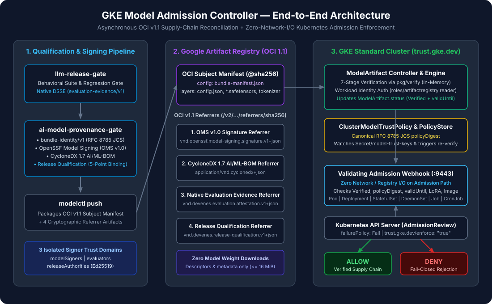
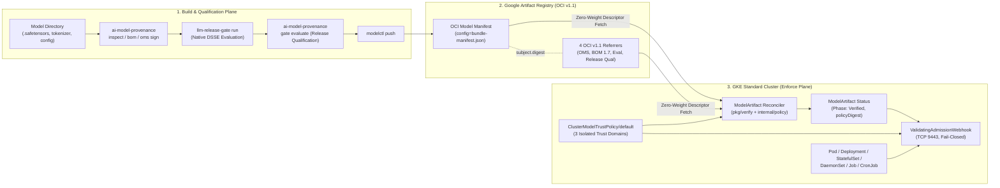

<div align="center">

# GKE Model Admission Controller

### Cryptographic Supply-Chain Provenance, Behavioral Qualification, and Fail-Closed Kubernetes Admission Control for AI Models on GKE

*Verify that every AI foundation model and LoRA adapter deployed on Google Kubernetes Engine is content-addressed (`bundle-identity/v1`), OpenSSF-signed (`OMS v1.0`), documented (`CycloneDX 1.7 AI/ML-BOM`), behaviorally qualified (`llm-release-gate`), and bound to an immutable serving runtime—without downloading multi-gigabyte model weights into the controller pod.*

[](https://github.com/devenes/gke-model-admission-controller/actions/workflows/ci.yml)
[](go.mod)
[](docs/guides/gke-deployment.md)
[](terraform/)
[](charts/model-admission-controller/)
[](docs/adr/ADR-002-oci-model-artifact.md)
[](docs/concepts/ai-ml-bom.md)
[](docs/concepts/model-signing.md)
[](docs/concepts/in-toto-attestations.md)
[](LICENSE)

[**Architecture**](docs/architecture/overview.md) • [**Quick Start**](docs/QUICKSTART.md) • [**Live Workshop Runbook**](docs/WORKSHOP.md) • [**13-Part Tutorial Series**](docs/tutorials/01-understanding-ai-model-admission.md) • [**Security Model**](docs/security/threat-model.md) • [**GKE Deployment**](docs/guides/gke-deployment.md) • [**Operations**](docs/operations/day-two-operations.md)

</div>

---

## Why This Project Exists

Traditional Kubernetes admission controllers (such as Binary Authorization, Sigstore Policy Controller, or Kyverno) verify **container images**—for example, `vllm/vllm-openai@sha256:...`.

However, in modern AI inference architectures on GKE, **the container image is only the execution engine**. The actual intelligence—multi-gigabyte `.safetensors` weights, `tokenizer.json`, `chat_template.jinja`, `generation_config.json`, and fine-tuned LoRA adapters—is loaded dynamically at runtime from external storage or OCI registries.

An organization can run a signed, vulnerability-scanned `vllm` container image and still suffer a critical production compromise if:

1. **Weights or tokenizers are tampered with** after training (`BUNDLE_ID_MISMATCH`).
2. **Unsafe serialization formats** (`.pkl` / `.pt` pickle payloads) or `config.json` `auto_map` remote code hooks are loaded (`UNSAFE_PICKLE_DETECTED`, `REMOTE_CODE_HOOKS_DETECTED`).
3. **Behavioral evaluation is bypassed or forged**—for example, deploying a model that failed safety/regression gates (`EVALUATION_INVALID`) or reusing a model-signing key to self-approve evaluation (`UNTRUSTED_SIGNER`).
4. **Evidence is transplanted** from a passing model onto an unverified model (`RELEASE_QUALIFICATION_INVALID`).
5. **LoRA adapters are paired with an unverified or mismatched base model** (`BASE_MODEL_UNVERIFIED`, `LORA_BASE_MISMATCH`).
6. **Workloads omit model governance annotations or self-assign break-glass exemptions** (`MISSING_MODEL_ARTIFACT_REF`, `UNAUTHORIZED_EXEMPTION`).

---

## What It Solves

- **Zero-Weight-Download OCI Verification**: Recomputes deterministic `bundle-identity/v1` digests directly from OCI v1.1 manifest layer descriptors (`org.opencontainers.image.title`, `digest`, `size`) and verifies 4 OCI Referrer artifacts in `< 300 ms`—without downloading multi-gigabyte `.safetensors` blobs to the controller pod.
- **Three Isolated Cryptographic Trust Domains**: Enforces strict separation between **Model Signers** (`OMS v1.0`), **Trusted Evaluators** (`evaluation-evidence/v1`), and **Release Authorities** (`release-qualification/v1`). Cross-domain key reuse is deterministically rejected.
- **Cross-Evidence Digest Pinning**: Verifies that the signed `release-qualification/v1` attestation cryptographically pins the exact digests of `bundle-manifest.json`, CycloneDX 1.7 `bom.cdx.json`, `oms.sig.json`, `report.json`, and `evaluation.dsse.json`, plus the `@sha256:` serving runtime image and serving configuration digest.
- **Compositional LoRA Trust (`baseModelRef`)**: Validates both the LoRA adapter's own provenance chain and its cryptographic lineage binding (`baseModelBundleId`) to a currently `Verified` parent `ModelArtifact`, with dynamic field-indexed re-reconciliation.
- **Fail-Closed Admission Across All 6 Workload Kinds**: Intercepts `Pod`, `Deployment`, `StatefulSet`, `DaemonSet`, `Job`, and `CronJob` in protected namespaces (`model-admission.gke.io/enforce: "true"`), blocking unannotated model-serving containers and unauthorized `trust.gke.dev/exempt` attempts.
- **Verified on Real GKE**: Validated end-to-end on Google Kubernetes Engine (`us-west4-a`) across **42 live cluster scenarios** (`10` positive, `28` adversarial negative, and `4` high-availability resilience scenarios).

---

## Container Admission vs. AI Model Admission

| Security Dimension | Traditional Container Admission (`cosign` / BinAuthz) | GKE Model Admission Controller (`trust.gke.dev/v1alpha1`) |
|---|---|---|
| **Primary Subject** | Container image (`vllm/vllm-openai@sha256:...`) | Multi-file AI model bundle (`weights`, `tokenizer`, `config`, `chat_template`, `LoRA`) + runtime image + serving config |
| **Content Identity** | OCI container manifest digest | Three linked digest domains: `bundle-identity/v1` (RFC 8785 JCS), OMS v1.0 Root Digest, and OCI v1.1 Manifest Digest |
| **Bill of Materials** | OS / package SBOM (SPDX / CycloneDX) | **CycloneDX 1.7 AI/ML-BOM** with model card validation and per-file SHA-256 verification |
| **Behavioral Gate** | Static CVE / SAST scan | **Native `llm-release-gate` DSSE attestation** (`NATIVE_CI_EVALUATOR`) pinning `suite_digest`, `dataset_digest`, and `PASS` status |
| **Trust Domain Separation** | Single image signer or CI identity | **3 isolated cryptographic domains**: `modelSigners`, `evaluatorSigners`, `releaseSigners` |
| **Compositional Lineage** | Base container layer history | **LoRA `baseModelRef` composition** verifying `baseModelBundleId` and parent `ModelArtifact` health |
| **Format & Hook Safety** | Not inspected | Blocks `.pkl`/`.pt` pickle payloads (`rejectUnsafePickle`) and `auto_map` hooks (`rejectRemoteCodeHooks`) |

---

## System Architecture



### Three-Repository Supply-Chain Ecosystem

This project is the Kubernetes enforcement plane of a three-repository AI supply-chain security architecture:

| Repository | Responsibility | Go Integration Surface |
|---|---|---|
| **[`llm-release-gate`](https://github.com/devenes/llm-release-gate)** | Executes behavioral evaluation suites and datasets against candidate models, binds execution to `bundle-manifest.json`, and signs native `evaluation-evidence/v1` DSSE attestations at evaluation time | `github.com/devenes/llm-release-gate/pkg/attestation` |
| **[`ai-model-provenance-gate`](https://github.com/devenes/ai-model-provenance-gate)** | Computes deterministic `bundle-identity/v1` manifests, generates CycloneDX 1.7 AI/ML-BOMs, signs OpenSSF Model Signing (`OMS v1.0`) envelopes, issues `release-qualification/v1` attestations, and exposes the zero-disk verification library | `github.com/devenes/ai-model-provenance-gate/pkg/verify` |
| **[`gke-model-admission-controller`](https://github.com/devenes/gke-model-admission-controller)** *(This Repository)* | Packages OCI v1.1 model bundles + 4 Referrers (`modelctl`), reconciles `ClusterModelTrustPolicy` and `ModelArtifact` CRDs on GKE, and enforces fail-closed admission (`ValidatingAdmissionWebhook`) | `cmd/controller`, `cmd/modelctl`, `cmd/gke-e2e` |



---

## End-to-End Trust Flow (10 Steps)

1. **Deterministic Bundle Identity (`bundle-identity/v1`)**: `ai-model-provenance inspect` inventories all files in the model directory, classifies their roles, checks for forbidden `.pkl` or `auto_map` hooks, and computes `bundle_id` and `manifest_digest` via RFC 8785 JCS.
2. **CycloneDX 1.7 AI/ML-BOM (`bom.cdx.json`)**: `ai-model-provenance bom generate` emits a CycloneDX 1.7 BOM containing the model card and per-file SHA-256 hashes, canonicalized via RFC 8785 JCS (`BOMResult.CanonicalHash`).
3. **OpenSSF Model Signing v1.0 (`oms.sig.json`)**: `ai-model-provenance oms sign` signs the per-file inventory and OMS v1.0 root digest using the **Model Signer** ECDSA P-256 key (`modelSigners`).
4. **Native Behavioral Evaluation (`report.json` + `evaluation.dsse.json`)**: `llm-release-gate run --bundle-manifest ... --signing-key ...` executes the evaluation suite, verifies the bundle manifest, and signs an `evaluation-evidence/v1` DSSE attestation (`NATIVE_CI_EVALUATOR`) using the **Trusted Evaluator** key (`evaluatorSigners`).
5. **Release Qualification (`release-qualification.dsse.json`)**: `ai-model-provenance gate evaluate` verifies steps 1–4, binds the `@sha256:` serving runtime image and serving config digest, and signs `release-qualification/v1` using the **Release Authority** key (`releaseSigners`).
6. **OCI v1.1 Packaging (`modelctl push`)**: Uploads the raw model files as uncompressed OCI layers, `bundle-manifest.json` as the OCI `config` blob, and the 4 evidence artifacts as OCI v1.1 Referrer manifests (`subject.digest`) to Google Artifact Registry.
7. **Policy Reconciliation (`ClusterModelTrustPolicy/default`)**: `ClusterModelTrustPolicyReconciler` validates all PEM public keys across the three trust domains and computes the RFC 8785 JCS `status.policyDigest`.
8. **Zero-Weight `ModelArtifact` Verification**: `ModelArtifactReconciler` fetches only the OCI manifest descriptors, config blob (`< 10 KB`), and 4 referrer blobs (`< 50 KB`), recomputes `bundle-identity/v1` in memory without downloading `.safetensors` weights, runs the 7-step `pkg/verify` pipeline, and sets `status.phase = Verified`.
9. **Synchronous Workload Admission (`/validate-workloads`)**: When a `Deployment`, `StatefulSet`, `DaemonSet`, `Job`, `CronJob`, or `Pod` is submitted to `ai-serving`, the webhook verifies `status.phase == Verified`, `observedGeneration == generation`, `evaluatedPolicyDigest == policy.status.policyDigest`, `now < validUntil`, LoRA `baseModelRef` health, `@sha256:` runtime image pinning, and `serving-config-digest`.
10. **Continuous Re-Evaluation on Policy or Parent Change**: Rotating a key in `ClusterModelTrustPolicy/default` or modifying a parent base `ModelArtifact` immediately invalidates stale `policyDigest` bindings and re-queues dependent `ModelArtifact` and LoRA resources.

### Deep-Dive Visual Diagrams

- **[Three-Domain Digest Model (`docs/assets/diagrams/digest-model.svg`)](docs/architecture/digest-model.md)**
- **[OCI v1.1 Model Bundle & 4-Referrer Layout (`docs/assets/diagrams/oci-evidence-architecture.svg`)](docs/concepts/oci-model-bundles.md)**
- **[Synchronous Admission Sequence (`docs/assets/diagrams/admission-sequence.svg`)](docs/architecture/admission-flow.md)**
- **[LoRA Compositional Trust (`docs/assets/diagrams/lora-trust-composition.svg`)](docs/concepts/lora-composition.md)**

---

## Security in Action: Positive vs. Negative Admission

### 1. Approved Model Deployment (`ALLOWED`)

When `ModelArtifact/gemma-2b-it` is `Verified` under the active `ClusterModelTrustPolicy/default` and the workload uses the attested `@sha256:` runtime image and serving configuration digest:

```bash
kubectl apply -f examples/positive-deployment.yaml
# Output:
# deployment.apps/gemma-vllm-serving created
```

### 2. Unannotated vLLM Workload in Protected Namespace (`DENIED — N-26`)

Attempting to deploy a `vllm` container in `ai-serving` (`model-admission.gke.io/enforce: "true"`) **without** `trust.gke.dev/model-artifact`:

```bash
kubectl apply -f examples/negative-unannotated-vllm.yaml
```

```text
Error from server (Forbidden): error when creating "examples/negative-unannotated-vllm.yaml":
admission webhook "validate-workloads.trust.gke.dev" denied the request:
[MISSING_MODEL_ARTIFACT_REF] workload in protected namespace runs a model-serving container or carries model labels without trust.gke.dev/model-artifact annotation
```

### 3. Mutable `:latest` Runtime Container Image Tag (`DENIED — N-23`)

Attempting to reference a `Verified` `ModelArtifact` while using a mutable `:latest` container image tag:

```bash
kubectl apply -f examples/negative-mutable-runtime-tag.yaml
```

```text
Error from server (Forbidden): error when creating "examples/negative-mutable-runtime-tag.yaml":
admission webhook "validate-workloads.trust.gke.dev" denied the request:
[RUNTIME_IMAGE_NOT_DIGEST_PINNED] container "vllm" image "us-west4-docker.pkg.dev/PROJECT_ID/models/vllm-runtime:latest" must be pinned by @sha256: digest
```

### 4. Unauthorized Self-Assigned Exemption (`DENIED — N-27`)

Attempting to bypass admission by adding `trust.gke.dev/exempt: "true"` as an unauthorized caller:

```bash
kubectl apply --as=system:serviceaccount:ai-serving:unauthorized-deployer \
  -f examples/negative-unauthorized-exemption.yaml
```

```text
Error from server (Forbidden): error when creating "examples/negative-unauthorized-exemption.yaml":
admission webhook "validate-workloads.trust.gke.dev" denied the request:
[UNAUTHORIZED_EXEMPTION] caller "system:serviceaccount:ai-serving:unauthorized-deployer" is not authorized to use trust.gke.dev/exempt in ClusterModelTrustPolicy
```

---

## Technology Stack

| Layer | Technology | Version / Specification |
|---|---|---|
| **Language & Runtime** | Go (`gcr.io/distroless/static:nonroot`) | `1.25.0` |
| **Kubernetes Operator Framework** | `controller-runtime` / `client-go` | `v0.20.2` / `v0.32.2` |
| **OCI Registry & Referrers Client** | `google/go-containerregistry` | `v0.20.3` (OCI Image & Distribution Spec v1.1) |
| **Cryptographic Provenance Engine** | `ai-model-provenance-gate/pkg/verify` | `bundle-identity/v1`, `OMS v1.0`, `CycloneDX 1.7`, `release-qualification/v1`, RFC 8785 JCS |
| **Behavioral Evaluation Engine** | `llm-release-gate/pkg/attestation` | `llm-release-gate.report/v1`, `evaluation-evidence/v1` (`NATIVE_CI_EVALUATOR`) |
| **Cloud Infrastructure (IaC)** | Terraform (`hashicorp/google`) | Terraform `>= 1.6.0`, Provider `~> 6.0` |
| **Target Kubernetes Platform** | Google Kubernetes Engine (GKE Standard) | Zonal CPU-Only (`2 x e2-standard-2`), Workload Identity |
| **Packaging & TLS Management** | Helm + `cert-manager` | Helm `3.14+`, `cert-manager` `v1.17.1` |
| **Observability** | Prometheus + Google Cloud Monitoring | 11 custom metrics on `:8080/metrics` + Terraform Cloud Monitoring Dashboard |

---

## Quick Start

### Option A: Zero-Cloud Local Verification (< 2 Minutes)

Run the entire unit, race-detector, in-memory OCI v1.1 registry, and 28-scenario adversarial security test suite locally with **zero cloud credentials**:

```bash
# 1. Build controller, modelctl, and gke-e2e
make build

# 2. Run all unit, OCI zero-weight-download, pipeline, and 28-scenario security matrix tests
go test -race -v ./...

# 3. Validate Helm chart and Terraform configurations offline
helm lint ./charts/model-admission-controller
terraform -chdir=terraform fmt -check -recursive
```

Want to walk through the complete 3-CLI supply-chain workflow (`ai-model-provenance` -> `llm-release-gate` -> `modelctl`) on local synthetic fixtures? Follow the **[5-Minute Local Quickstart Guide](docs/QUICKSTART.md)**.

### Option B: Full GKE Deployment & 42-Scenario Live Verification

1. **Provision GKE & Artifact Registry with Terraform**:
   ```bash
   cp terraform/environments/demo/terraform.tfvars.example terraform/environments/demo/terraform.tfvars
   # Edit terraform/environments/demo/terraform.tfvars with your project_id
   terraform -chdir=terraform init
   terraform -chdir=terraform apply -var-file=environments/demo/terraform.tfvars
   ```
2. **Install `cert-manager` and the Admission Controller Helm Chart**:
   See the step-by-step commands in the **[GKE Deployment Guide](docs/guides/gke-deployment.md)**.
3. **Run the 42-Scenario Live GKE E2E Suite**:
   ```bash
   ./bin/gke-e2e \
     --registry "${REGION}-docker.pkg.dev" \
     --repo-prefix "${PROJECT_ID}/models"
   ```

---

## 13-Part Step-by-Step Tutorial Series

Every tutorial includes architecture context, required inputs, exact copy-pasteable commands, verified outputs, troubleshooting, and security considerations:

| # | Tutorial | What You Will Build / Verify |
|---|---|---|
| **01** | [Understanding AI Model Supply-Chain Admission Control](docs/tutorials/01-understanding-ai-model-admission.md) | Build all 5 binaries (`controller`, `modelctl`, `gke-e2e`, `ai-model-provenance`, `llm-release-gate`) and generate 3 isolated ECDSA P-256 trust-domain keypairs |
| **02** | [Creating a Deterministic Model Bundle (`bundle-identity/v1`)](docs/tutorials/02-creating-a-model-bundle.md) | Inspect `.safetensors` fixtures and compute RFC 8785 JCS `bundle_id` and `manifest_digest` |
| **03** | [Generating a CycloneDX 1.7 AI/ML-BOM](docs/tutorials/03-generating-ai-ml-bom.md) | Generate and validate `bom.cdx.json` with model card and per-file SHA-256 inventory |
| **04** | [Signing Model Artifacts with OpenSSF Model Signing v1.0](docs/tutorials/04-signing-model-artifacts.md) | Sign and verify `oms.sig.json` (`https://model_signing/signature/v1.0`) |
| **05** | [Running Behavioral Evaluation with `llm-release-gate`](docs/tutorials/05-running-llm-release-gate-evaluation.md) | Execute evaluation cases and emit native `evaluation-evidence/v1` DSSE (`NATIVE_CI_EVALUATOR`) |
| **06** | [Creating the Release Qualification Attestation](docs/tutorials/06-creating-release-qualification-attestation.md) | Cross-bind all 5 upstream digests + `@sha256:` runtime image + serving config into `release-qualification.dsse.json` |
| **07** | [Publishing to Artifact Registry (`modelctl push`)](docs/tutorials/07-publishing-to-artifact-registry.md) | Push the OCI v1.1 model bundle + 4 Referrers and generate `ModelArtifact` YAML |
| **08** | [Provisioning GKE & Artifact Registry with Terraform](docs/tutorials/08-provisioning-gke-with-terraform.md) | Provision the 2-node CPU-only GKE cluster, VPC, webhook firewall, and Workload Identity IAM |
| **09** | [Installing `cert-manager` & the Admission Controller](docs/tutorials/09-installing-the-admission-controller.md) | Build the distroless image, pin by `@sha256:`, and deploy the 2-replica Helm chart |
| **10** | [Configuring `ClusterModelTrustPolicy`](docs/tutorials/10-configuring-cluster-model-trust-policy.md) | Configure the 3 trust domains and verify RFC 8785 JCS `status.policyDigest` |
| **11** | [Registering and Verifying a `ModelArtifact`](docs/tutorials/11-registering-a-modelartifact.md) | Reconcile `ModelArtifact/gemma-2b-it` in `< 300 ms` with zero weight downloads |
| **12** | [Deploying an Approved Model Workload (`P-01` – `P-10`)](docs/tutorials/12-deploying-an-approved-model-workload.md) | Deploy verified inference workloads and LoRA compositions in `ai-serving` |
| **13** | [Testing Adversarial Security Failures (`N-01` – `N-28`)](docs/tutorials/13-testing-security-failures.md) | Execute negative attack manifests and the 42-scenario `./bin/gke-e2e` suite |

---

## Documentation Navigation by Role

| Role | Recommended Starting Points |
|---|---|
| **Platform / GKE Engineers** | [GKE Deployment Guide](docs/guides/gke-deployment.md) • [Terraform Guide](docs/guides/terraform-guide.md) • [Helm Installation](docs/guides/helm-installation.md) • [Monitoring & 11 Prometheus Metrics](docs/guides/monitoring.md) • [Day-Two Operations](docs/operations/day-two-operations.md) |
| **Security Architects & Auditors** | [Threat Model & 28-Scenario Matrix](docs/security/threat-model.md) • [Security Guarantees](docs/SECURITY_GUARANTEES.md) • [Trust Domains](docs/concepts/trust-domains.md) • [Audit Mode & Exemptions](docs/guides/audit-mode.md) • [Limitations](docs/LIMITATIONS.md) |
| **ML / Release Engineers** | [5-Minute Quickstart](docs/QUICKSTART.md) • [CLI Command Reference](docs/COMMAND_REFERENCE.md) • [Artifact Registry & `modelctl`](docs/guides/artifact-registry.md) • [LoRA Composition (`baseModelRef`)](docs/concepts/lora-composition.md) • [Troubleshooting Failure Codes](docs/guides/troubleshooting.md) |
| **Open-Source Contributors** | [Architecture Overview](docs/architecture/overview.md) • [ADR-001 Verifier API](docs/adr/ADR-001-verifier-api.md) • [ADR-002 OCI Layout](docs/adr/ADR-002-oci-model-artifact.md) • [ADR-003 Release Attestation](docs/adr/ADR-003-release-attestation.md) • [Local Development Guide](docs/guides/local-development.md) • [Contributing Guide](CONTRIBUTING.md) |

For the complete table of contents across all 55+ documentation pages, see the **[Documentation Index (`docs/README.md`)](docs/README.md)**.

---

## Repository Structure

```text
gke-model-admission-controller/
├── api/v1alpha1/                      # CRD Go types (ModelArtifact, ClusterModelTrustPolicy)
├── charts/model-admission-controller/ # Helm chart (CRDs, Deployment, Webhook, Cert, PDB, RBAC)
├── cmd/
│   ├── controller/                    # Kubernetes operator & ValidatingAdmissionWebhook binary
│   ├── modelctl/                      # OCI v1.1 model bundle + 4-referrer packager CLI
│   └── gke-e2e/                       # 42-scenario real-GKE verification & security runner
├── config/crd/bases/                  # Standalone CustomResourceDefinition YAML manifests
├── docs/                              # Full documentation suite, SVG diagrams, 13 tutorials, ADRs
├── examples/                          # Synthetic fixtures, policies, and positive/negative workloads
├── internal/
│   ├── controller/                    # ModelArtifact & ClusterModelTrustPolicy reconcilers
│   ├── metrics/                       # 11 Prometheus metrics registered with controller-runtime
│   ├── policy/                        # 9-rule trust policy evaluator & RFC 8785 JCS policyDigest
│   ├── registry/                      # Zero-weight OCI v1.1 client & Referrers resolver
│   └── webhook/                       # Fail-closed ValidatingAdmissionWebhook handler
├── terraform/                         # GCP VPC, GKE Standard Zonal, Artifact Registry, IAM, Monitoring
└── tests/                             # End-to-end pipeline & 28-scenario security matrix tests
```

---

## Known Limitations & Security Boundaries

We document what this system guarantees—and what requires complementary controls—transparently:

1. **Zero-Weight OCI Descriptor Verification vs. Node-Level Blob Read Verification**: During reconciliation, the controller verifies OCI manifest and layer descriptors from Artifact Registry without downloading multi-gigabyte `.safetensors` blobs into the controller pod. To prevent a compromised registry storage backend from serving different bytes when the inference pod pulls the weights on the worker node, pair this admission controller with an init-container/CSI fetcher that verifies each file's SHA-256 against `bundle-manifest.json` on download.
2. **Admission-Time Gate vs. Post-Start Container Mutation**: Kubernetes `ValidatingAdmissionWebhooks` inspect `CREATE` and `UPDATE` API requests. Pair this controller with restricted `kubectl exec` RBAC, read-only container root filesystems, and runtime security monitoring.
3. **Static PEM Public Keys in v0.1.0**: `ClusterModelTrustPolicy` currently verifies ECDSA P-256 PEM keys (`publicKeyPEM`). Keyless Sigstore Fulcio OIDC + Rekor transparency log verification is on the roadmap.

See **[Limitations & Future Work (`docs/LIMITATIONS.md`)](docs/LIMITATIONS.md)** for full details.

---

## Contributing & Security Reporting

- **Contributing**: See [CONTRIBUTING.md](CONTRIBUTING.md) and [CODE_OF_CONDUCT.md](CODE_OF_CONDUCT.md).
- **Security Vulnerabilities**: Please report suspected vulnerabilities privately via [SECURITY.md](SECURITY.md) / [Responsible Disclosure](docs/security/responsible-disclosure.md).

---

## License

Released under the [MIT License](LICENSE).
