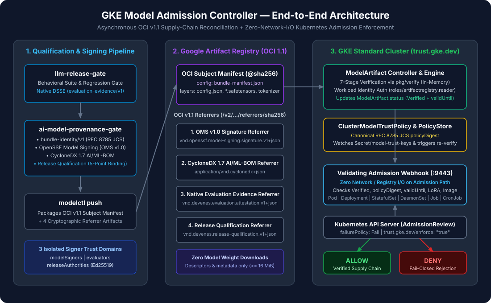
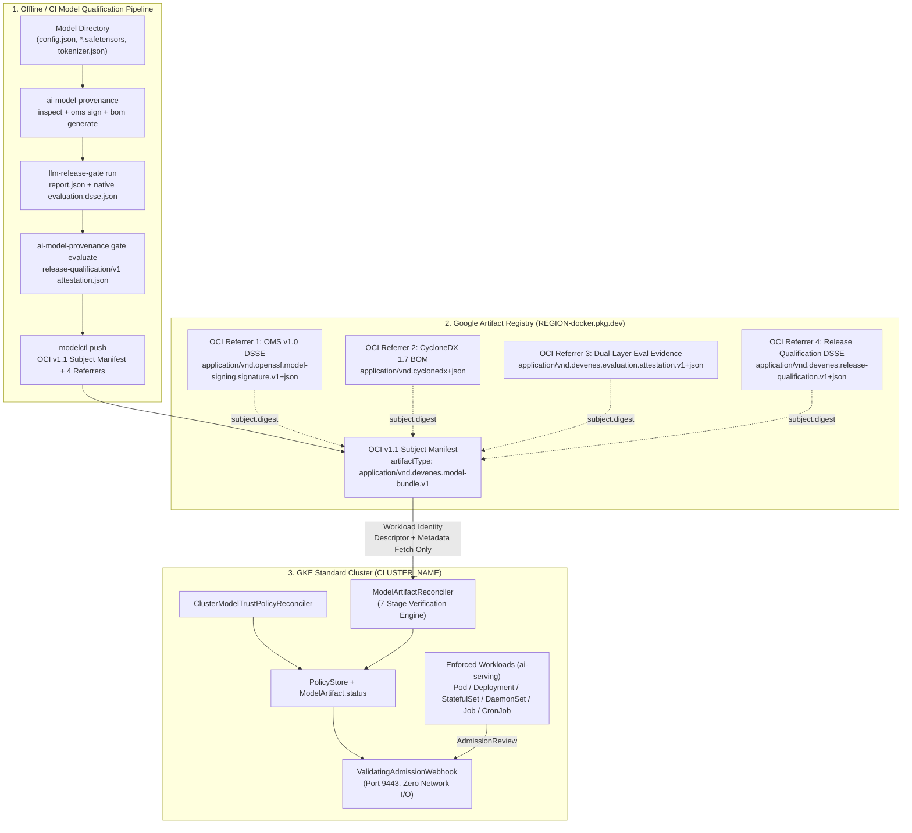
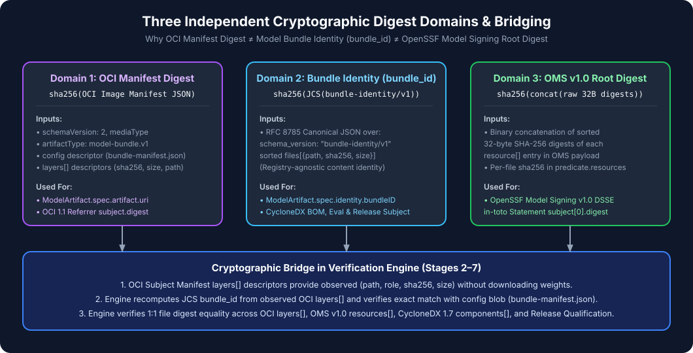

# Architecture: GKE Model Admission Controller

## 1. Executive Overview

`gke-model-admission-controller` is a Kubernetes security controller and `ValidatingAdmissionWebhook` purpose-built for Google Kubernetes Engine (GKE). It enforces cryptographic supply-chain provenance, CycloneDX 1.7 AI/ML-BOM completeness, native `llm-release-gate` behavioral evaluation qualification, and `ai-model-provenance-gate` release qualification before any AI/LLM serving workload is admitted to GKE.

The architecture strictly separates **asynchronous OCI registry verification** (`ModelArtifactReconciler` + `ClusterModelTrustPolicyReconciler`) from **synchronous admission enforcement** (`WorkloadValidator` `ValidatingAdmissionWebhook`). As a result:

1. **Zero Network/Registry I/O on the Admission Path**: The `ValidatingAdmissionWebhook` evaluates admission requests in `<50ms` solely against reconciled Kubernetes state (`ModelArtifact.status` and `ClusterModelTrustPolicy.status`) and the in-memory `PolicyStore`.
2. **Zero Model Weight Downloads**: The controller verifies multi-gigabyte model weight shards (`*.safetensors`) strictly via OCI Distribution v1.1 manifest descriptors and `bundle-manifest.json` without ever downloading weight blobs (`MaxMetadataBlobBytes = 16 MiB`).

---

## 2. High-Level Component Architecture

---

## 3. Three Independent Digest Domains & Bridging

A core architectural invariant of the controller (defined in [ADR-002](adr/ADR-002-oci-model-artifact.md)) is that three distinct cryptographic digest domains are never conflated and are explicitly bridged via the OCI Subject Manifest's `config` blob (`bundle-manifest.json`) and layer descriptors:

| Digest Domain | Computation | Where Used |
|---|---|---|
| **1. OCI Manifest Digest** | `sha256(raw OCI Image Manifest v1.1 JSON)` | `ModelArtifact.spec.artifact.uri`, OCI Referrer `subject.digest`, `GET /v2/<repo>/referrers/<digest>` |
| **2. Model Bundle Identity (`bundle_id`)** | `sha256(JCS({files, schema: "bundle-identity/v1"}))` | `ModelArtifact.spec.identity.bundleID`, `bundle-manifest.json`, CycloneDX 1.7 root component hash, `evaluation-evidence/v1` DSSE subject, `release-qualification/v1` DSSE subject |
| **3. OMS v1.0 Root Digest** | `sha256(concat(sorted raw 32-byte file digests))` | `oms.sig.json` DSSE `in-toto` subject digest |

---

## 4. Seven-Stage Reconciliation Pipeline (`internal/verification/verifier.go`)

When a `ModelArtifact` or `ClusterModelTrustPolicy` changes, `ModelArtifactReconciler` runs the 7-stage verification engine:

1. **Stage 1 — URI & Registry Allowlist**: Parses `spec.artifact.uri`, rejects mutable tags without `@sha256:<64-hex>`, and checks `ClusterModelTrustPolicy.spec.allowedRegistries`.
2. **Stage 2 — OCI Subject Manifest & Layer Descriptors**: Fetches the OCI Subject Manifest, verifies its SHA-256 digest and `artifactType`, and extracts `(path, role, sha256, size)` from `layers[]` descriptors without downloading weight layers.
3. **Stage 3 — `bundle-manifest.json` & `bundle-identity/v1` Verification**: Fetches the `config` blob, recomputes the RFC 8785 JCS `manifest_digest` and `bundle_id` from the observed OCI layer descriptors via `ai-model-provenance-gate/pkg/verify`, verifies `bm.BundleID == spec.identity.bundleID`, and validates LoRA `verified_base_bundle_id` against the referenced base `ModelArtifact`.
4. **Stage 4 — OpenSSF Model Signing (OMS v1.0) Referrer**: Discovers the OMS referrer via `/v2/<repo>/referrers/<digest>`, verifies `subject.digest`, and validates the Ed25519 DSSE signature and per-file resource digests against `trustDomains.modelSigners` (detecting cross-domain key confusion against `AllDomainCandidates`).
5. **Stage 5 — CycloneDX 1.7 AI/ML-BOM Referrer**: Discovers and fetches the BOM referrer blob, validates CycloneDX 1.7 schema compliance, verifies root `bundle_id` and component file hashes, and computes the canonical JCS `bom.digest`.
6. **Stage 6 — Dual-Layer `llm-release-gate` Evaluation Referrer**: Discovers the evaluation referrer containing both `evaluation.dsse.json` and `report.json`, verifies the Ed25519 signature against `trustDomains.evaluators`, enforces `gateStatus == "PASS"`, `evidenceQuality == "COMPLETE"`, `bindingMode == "NATIVE_EVALUATOR"` (rejecting `POST_HOC_OPERATOR`), `suite.digest`, `dataset.digest`, and evidence freshness (`maxEvidenceAgeHours`).
7. **Stage 7 — Release Qualification & 5-Point Cross-Evidence Binding**: Discovers the `release-qualification/v1` referrer signed by `trustDomains.releaseAuthorities` and verifies exact cross-evidence digest equality across all 5 artifacts (`bundle.manifest_digest`, `bom.digest`, `oms_verification.signature_digest`, `evaluation.report_digest`, `evaluation.attestation_digest`) plus `runtime_image` and `serving_config_digest`.
