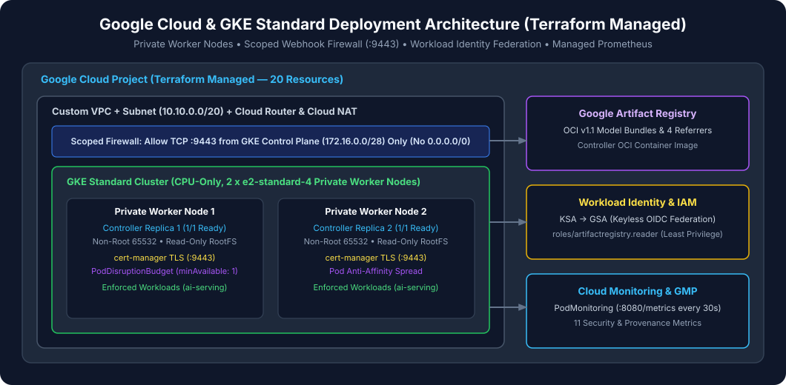

# GKE Deployment & Terraform Runbook

## 1. Target Google Cloud Architecture

- **GCP Project**: `PROJECT_ID`
- **Region / Zone**: `REGION` (default `us-west4`) / `ZONE` (default `us-west4-a`)
- **GKE Cluster**: `CLUSTER_NAME` (default `gke-model-admission-demo`, GKE Standard zonal, CPU-only `2 x e2-standard-4`, private worker nodes `enable_private_nodes = true`, Workload Identity `PROJECT_ID.svc.id.goog`, Managed Prometheus enabled)
- **Google Artifact Registry**: `REGION-docker.pkg.dev/PROJECT_ID/models`
- **Cloud Monitoring Dashboard**: `GKE Model Admission Controller Security & Provenance`



---

## 2. Provisioning Infrastructure via Terraform

All Google Cloud resources are managed exclusively through Terraform under [`terraform/`](../terraform/main.tf):

```bash
cp terraform/environments/demo/terraform.tfvars.example terraform/environments/demo/terraform.tfvars
# Edit terraform/environments/demo/terraform.tfvars to set project_id = "PROJECT_ID"

cd terraform
terraform init
terraform fmt -check -recursive
terraform validate
terraform plan -var-file=environments/demo/terraform.tfvars -out=tfplan
terraform apply tfplan
rm -f tfplan
```

Configure `kubectl` access:

```bash
gcloud container clusters get-credentials CLUSTER_NAME \
  --zone ZONE \
  --project PROJECT_ID
kubectl get nodes -o wide
```

---

## 3. Deploying `cert-manager`, CRDs, and `model-admission-controller`

### Step 1: Install `cert-manager`

```bash
helm repo add jetstack https://charts.jetstack.io
helm repo update
helm upgrade --install cert-manager jetstack/cert-manager \
  --namespace cert-manager \
  --create-namespace \
  --set crds.enabled=true \
  --wait
```

### Step 2: Install CustomResourceDefinitions (`trust.gke.dev/v1alpha1`)

```bash
kubectl apply -f config/crd/
```

### Step 3: Deploy `model-admission-controller` Helm Chart

```bash
helm upgrade --install model-admission-controller ./charts/model-admission-controller \
  --namespace model-admission-system \
  --create-namespace \
  --set image.repository="REGION-docker.pkg.dev/PROJECT_ID/models/gke-model-admission-controller" \
  --set image.digest="sha256:9ca52f2367a58106b6081085e6d3c9020409e03dbc34e21155f06600e8d83c93" \
  --set serviceAccount.gcpServiceAccount="gke-model-admission-controller@PROJECT_ID.iam.gserviceaccount.com" \
  --wait
```
