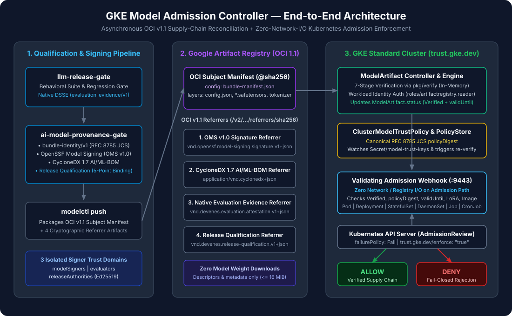

# GKE Model Admission Controller — Documentation Hub

Welcome to the technical documentation for **GKE Model Admission Controller** (`trust.gke.dev/v1alpha1`).

This system is the Kubernetes admission and enforcement plane of a three-repository AI model supply-chain security architecture:

1. **[`llm-release-gate`](https://github.com/devenes/llm-release-gate)** — Behavioral evaluation, regression gating, and evaluation-time DSSE attestation signing (`evaluation-evidence/v1`).
2. **[`ai-model-provenance-gate`](https://github.com/devenes/ai-model-provenance-gate)** — Deterministic `bundle-identity/v1` calculation, OpenSSF Model Signing (OMS v1.0), CycloneDX 1.7 AI/ML-BOM generation, 5-point Release Qualification (`release-qualification/v1`), and the pure in-memory Go verification API (`pkg/verify`).
3. **[`gke-model-admission-controller`](https://github.com/devenes/gke-model-admission-controller)** — OCI v1.1 Referrer discovery, descriptor-only (zero-weight-download) supply-chain reconciliation, `ClusterModelTrustPolicy` & `ModelArtifact` CRDs, and a zero-network-I/O `ValidatingAdmissionWebhook` for Google Kubernetes Engine (GKE).

---

## Navigate by Persona

### 1. Platform Engineer

Deploy, operate, and monitor the admission controller and its Google Cloud infrastructure.

- **[Quick Start](QUICKSTART.md)** — Shortest path from clone to verified local checks and GKE deployment.
- **[Hands-On Workshop & Live Demo Runbook](WORKSHOP.md)** — Step-by-step instructor & audience guide (45–60 min laptop lab or 75–90 min live GKE session).
- **[GKE Deployment & Terraform Runbook](GKE_DEPLOYMENT.md)** — Provisioning VPC, Cloud NAT, private GKE Standard nodes, Artifact Registry, and Workload Identity via Terraform.
- **[Terraform Guide](guides/terraform-guide.md)** — Detailed breakdown of the 20 Terraform-managed GCP resources.
- **[Helm Installation Guide](guides/helm-installation.md)** — Installing `cert-manager`, CRDs, and the 2-replica HA controller chart.
- **[Operations & Observability Guide](OPERATIONS.md)** — Prometheus metrics (`:8080/metrics`), Google Cloud Managed Service for Prometheus (`PodMonitoring`), key rotation, and `Audit`/`Enforce` transitions.
- **[Troubleshooting Guide](TROUBLESHOOTING.md)** — Diagnosing structured rejection reasons, `caBundle` injection, and registry connectivity.

### 2. AI/ML Engineer

Package, sign, evaluate, qualify, and publish AI model bundles and LoRA adapters to Google Artifact Registry.

- **[Cross-Repository Integration Guide](INTEGRATION.md)** — How `llm-release-gate`, `ai-model-provenance-gate`, and `modelctl` connect.
- **[Concept: Bundle Identity (`bundle-identity/v1`)](concepts/bundle-identity.md)** — Deterministic RFC 8785 JCS identity over model files.
- **[Concept: OpenSSF Model Signing (OMS v1.0)](concepts/model-signing.md)** — Signing and verifying model bundle files.
- **[Concept: CycloneDX 1.7 AI/ML-BOM](concepts/ai-ml-bom.md)** — Generating 1:1 component inventories for weights, configs, tokenizers, and adapters.
- **[Concept: LoRA Trust Composition](concepts/lora-composition.md)** — Cryptographic binding between base models and PEFT/LoRA adapters.
- **[Tutorials 01–08: End-to-End Qualification & OCI Publishing](tutorials/01-understanding-ai-model-admission.md)** — Step-by-step hands-on walkthroughs using synthetic fixtures.

### 3. Kubernetes Security Engineer

Evaluate the cryptographic trust model, digest bridging, threat mitigations, and fail-closed guarantees.

- **[Architecture & 3-Domain Digest Bridging](ARCHITECTURE.md)** — Separation of reconciliation I/O from admission evaluation and how OCI, `bundle-identity/v1`, and OMS digests are bridged.
- **[Why This Architecture](WHY_THIS_ARCHITECTURE.md)** — Design decisions, trade-offs, and why verification runs in reconciliation rather than the admission request path.
- **[Security Guarantees](SECURITY_GUARANTEES.md)** — What the controller cryptographically guarantees prior to workload scheduling.
- **[Security Limitations](LIMITATIONS.md)** — Explicit non-guarantees and the boundary between `DEMO-READY` and `PRODUCTION-READY`.
- **[Threat Model (`TM-01` .. `TM-12`)](THREAT_MODEL.md)** — 12 supply-chain attack vectors and their mapping to the 28-scenario security matrix.
- **[Tutorial 13: Testing Security Failures & Attack Vectors](tutorials/13-testing-security-failures.md)** — Reproducing tamper, key-confusion, post-hoc evaluation, and TTL expiry denials.

### 4. Contributor

Understand the Go package layout, CLI flags, build targets, and testing strategy.

- **[Development Guide](DEVELOPMENT.md)** — Workspace layout, Go toolchain, and why real GKE is used instead of Kind/envtest.
- **[Command Reference](COMMAND_REFERENCE.md)** — Verified CLI flags for `manager`, `modelctl`, `gke-e2e`, `ai-model-provenance`, `llm-release-gate`, and `Makefile` targets.
- **[Environment Reference](ENVIRONMENT.md)** — Placeholders, environment variables, and credential resolution.
- **[Testing Strategy](TESTING.md)** — Unit tests, in-memory registry security matrix (`28/28`), and live GKE E2E runner.
- **[Technology Stack](TECH_STACK.md)** — Libraries, specifications, and version rationale.
- **[Contributing Guide](../CONTRIBUTING.md)** — Non-negotiable security invariants and PR checklist.

---

## Complete Documentation Map

| Section | Documents |
|---|---|
| **Architecture & ADRs** | [ARCHITECTURE.md](ARCHITECTURE.md) · [WHY_THIS_ARCHITECTURE.md](WHY_THIS_ARCHITECTURE.md) · [TECH_STACK.md](TECH_STACK.md) · [Overview](architecture/overview.md) · [System Architecture](architecture/system-architecture.md) · [Trust Model](architecture/trust-model.md) · [Data Flow](architecture/data-flow.md) · [Digest Model](architecture/digest-model.md) · [Admission Flow](architecture/admission-flow.md) · [Design Decisions](architecture/design-decisions.md) · [ADR-001](adr/ADR-001-verifier-api.md) · [ADR-002](adr/ADR-002-oci-model-artifact.md) · [ADR-003](adr/ADR-003-release-attestation.md) |
| **Core Concepts** | [ModelArtifact CRD](concepts/model-artifact.md) · [Bundle Identity](concepts/bundle-identity.md) · [Model Signing](concepts/model-signing.md) · [AI/ML-BOM](concepts/ai-ml-bom.md) · [in-toto Attestations](concepts/in-toto-attestations.md) · [Release Qualification](concepts/release-qualification.md) · [OCI Model Bundles](concepts/oci-model-bundles.md) · [Trust Domains](concepts/trust-domains.md) · [LoRA Composition](concepts/lora-composition.md) |
| **Practical Guides** | [Prerequisites](guides/prerequisites.md) · [Local Development](guides/local-development.md) · [GKE Deployment](guides/gke-deployment.md) · [Terraform Guide](guides/terraform-guide.md) · [Helm Installation](guides/helm-installation.md) · [Artifact Registry](guides/artifact-registry.md) · [Trust Policy Config](guides/trust-policy-configuration.md) · [ModelArtifact Registration](guides/modelartifact-registration.md) · [Admission Enforcement](guides/admission-enforcement.md) · [Audit Mode](guides/audit-mode.md) · [Monitoring](guides/monitoring.md) · [Troubleshooting](guides/troubleshooting.md) |
| **13-Part Tutorial Series** | [01 Understanding Admission](tutorials/01-understanding-ai-model-admission.md) · [02 Model Bundle](tutorials/02-creating-a-model-bundle.md) · [03 AI/ML-BOM](tutorials/03-generating-ai-ml-bom.md) · [04 OMS Signing](tutorials/04-signing-model-artifacts.md) · [05 Behavioral Evaluation](tutorials/05-running-llm-release-gate-evaluation.md) · [06 Release Qualification](tutorials/06-creating-release-qualification-attestation.md) · [07 OCI Publishing](tutorials/07-publishing-to-artifact-registry.md) · [08 Terraform GKE](tutorials/08-provisioning-gke-with-terraform.md) · [09 Installing Controller](tutorials/09-installing-the-admission-controller.md) · [10 Trust Policies](tutorials/10-configuring-cluster-model-trust-policy.md) · [11 Registering ModelArtifact](tutorials/11-registering-a-modelartifact.md) · [12 Deploying Workload](tutorials/12-deploying-an-approved-model-workload.md) · [13 Testing Attacks](tutorials/13-testing-security-failures.md) |
| **Operations & Security** | [Installation](operations/installation.md) · [Upgrade](operations/upgrade.md) · [Backup & Recovery](operations/backup-and-recovery.md) · [Certificate Rotation](operations/certificate-rotation.md) · [Policy Rotation](operations/policy-rotation.md) · [Incident Response](operations/incident-response.md) · [Day-2 Operations](operations/day-two-operations.md) · [SECURITY_GUARANTEES.md](SECURITY_GUARANTEES.md) · [LIMITATIONS.md](LIMITATIONS.md) · [THREAT_MODEL.md](THREAT_MODEL.md) |
