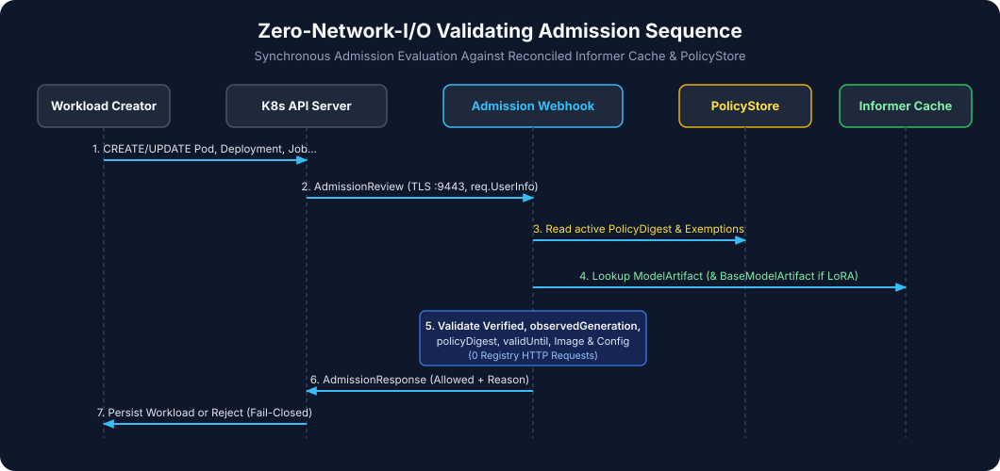

# Admission Flow & Sequence (`admission-flow.md`)

This document details the synchronous evaluation logic executed by [`WorkloadValidator`](../../internal/admission/validator.go) on every `AdmissionReview` request.

---

## 1. Intercepted Resources & Operations

Configured in [`charts/model-admission-controller/templates/validatingwebhook.yaml`](../../charts/model-admission-controller/templates/validatingwebhook.yaml):

- **Operations**: `CREATE`, `UPDATE`
- **Resources**:
  - `core/v1`: `pods`
  - `apps/v1`: `deployments`, `statefulsets`, `daemonsets`
  - `batch/v1`: `jobs`, `cronjobs`
- **Namespace Selector**: `trust.gke.dev/enforce: "true"`
- **Failure Policy**: `Fail` (if the webhook is unreachable or times out after `2s`, the Kubernetes API server rejects the request).

---

## 2. Step-by-Step Decision Tree in `EvaluateWorkload`

When an `AdmissionReview` arrives at `/validate-workloads`:

1. **Extract Pod Template & Metadata**:
   - For a `Pod`, inspects `pod.Annotations`, `pod.Labels`, and `pod.Spec`.
   - For a `Deployment`, `StatefulSet`, `DaemonSet`, or `Job`, merges top-level object annotations/labels with `spec.template.metadata` (`mergeAnnotations`) and inspects `spec.template.spec`.
   - For a `CronJob`, merges top-level annotations/labels with `spec.jobTemplate.spec.template.metadata` and inspects `spec.jobTemplate.spec.template.spec`.
2. **Resolve Active `ClusterModelTrustPolicy`**:
   - Reads the resolved policy from `PolicyStore` (or synchronously resolves `ClusterModelTrustPolicy/default` via `apiReader` on cold start).
   - If the policy is missing or `Ready == false`, returns **DENY (`ClusterPolicyNotReady`)**.
3. **Evaluate Non-Self-Assignable Exemptions**:
   - Calls `policy.IsExempt(pol.Policy, req.UserInfo.Username, podLabels)`.
   - Only returns **ALLOW (`ExemptWorkload`)** if `req.UserInfo.Username` (authenticated by the Kubernetes API Server) matches `exemptServiceAccounts` AND (when `exemptPodLabels` is configured) `podLabels` match all required exemption labels.
   - Workload-controlled fields such as `pod.spec.serviceAccountName` are **never** trusted for exemptions.
4. **Check `trust.gke.dev/model-artifact` Annotation**:
   - If the annotation is absent or empty, returns **DENY (`MissingModelArtifactReference`)** in `Enforce` mode (or **ALLOW with Kubernetes Warning** in `Audit` mode).
5. **Fetch `ModelArtifact` in the Workload's Namespace**:
   - Looks up `ModelArtifact/<name>` in `req.Namespace`.
   - If not found, returns **DENY (`ModelArtifactNotFound`)**.
6. **Verify Generation, Verification State, `policyDigest`, and TTL**:
   - Checks `ma.Status.ObservedGeneration == ma.Generation` (else **DENY (`StaleObservedGeneration`)**).
   - Checks `ma.Status.Verified == true` (else **DENY (`ma.Status.FailureReason`)**).
   - Checks `ma.Status.PolicyDigest == activePolicy.PolicyDigest` (else **DENY (`PolicyDigestMismatch`)**).
   - Checks `ma.Status.ValidUntil != nil && now <= ma.Status.ValidUntil` (else **DENY (`VerificationExpired`)**).
7. **Verify LoRA Base `ModelArtifact` (When `spec.runtime.baseModelArtifact` Is Set)**:
   - Looks up the base `ModelArtifact` in the same namespace.
   - Verifies that the base `ModelArtifact` is `Verified == true`, `ObservedGeneration == Generation`, `PolicyDigest == activePolicy.PolicyDigest`, `now <= ValidUntil`, and `baseMA.Status.VerifiedBundleID == ma.Status.VerifiedBaseBundleID`. Otherwise returns **DENY (`LoRABaseModelUnverified`)**.
8. **Verify Runtime Container Image Digest Pinning & Binding**:
   - Inspects every container in `podSpec.Containers` and `podSpec.InitContainers`.
   - If `requireImmutableRuntimeImage` is enabled and any container image lacks `@sha256:<64-hex>` (or combines `:tag@sha256:...`), returns **DENY (`MutableRuntimeImage`)**.
   - If `ma.Status.RuntimeImage` is non-empty and any container image does not match `ma.Status.RuntimeImage`, returns **DENY (`RuntimeImageMismatch`)**.
9. **Verify Serving Configuration Digest Binding**:
   - If `requireServingConfigBinding` is enabled and `ma.Status.ServingConfigDigest` is non-empty, verifies `annotations["trust.gke.dev/serving-config-digest"] == ma.Status.ServingConfigDigest`. Otherwise returns **DENY (`ServingConfigDigestMismatch`)**.
10. **Admit Workload**:
    - Increments `model_verification_cache_hits_total` and `model_admission_decisions_total{decision="allow",reason="Verified"}` and returns **ALLOW (`Verified`)**.
