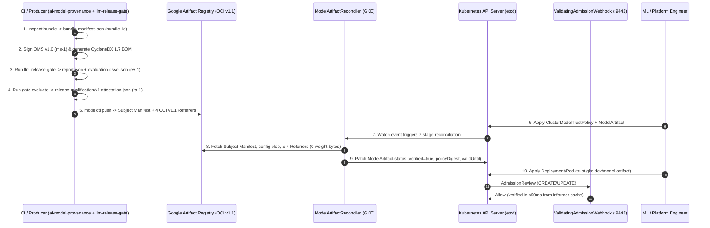

# End-to-End Data Flow

This document traces the complete lifecycle of an AI model artifact from local/CI creation to Kubernetes workload admission on GKE.

---

## 1. Ten-Stage End-to-End Data Flow

---

## 2. What Travels Over the Network at Each Phase

| Phase | Source -> Destination | Payload Transferred | Model Weights Transferred? |
|---|---|---|---|
| **Phase A: OCI Publishing (`modelctl push`)** | CI Runner -> Google Artifact Registry | Model files (`config.json`, `*.safetensors`, `tokenizer.json`), `bundle-manifest.json`, and 4 OCI Referrer artifacts (`oms.sig.json`, `bom.cdx.json`, `evaluation.dsse.json` + `report.json`, `attestation.json`). | Yes (uploaded once to Artifact Registry) |
| **Phase B: Reconciliation (`ModelArtifactReconciler`)** | GKE Controller Pod -> Google Artifact Registry | OCI Subject Manifest JSON, `bundle-manifest.json` config blob, `/v2/<repo>/referrers/<digest>` index JSON, and the 4 referrer manifests/blobs (each capped at `<= 16 MiB`). | **No (`0 bytes` of model weights fetched)** |
| **Phase C: Workload Admission (`ValidatingAdmissionWebhook`)** | Kubernetes API Server -> GKE Controller Pod (`:9443`) | Kubernetes `AdmissionReview` JSON (`Pod`, `Deployment`, `StatefulSet`, `DaemonSet`, `Job`, or `CronJob`). | **No (`0` external network calls)** |
