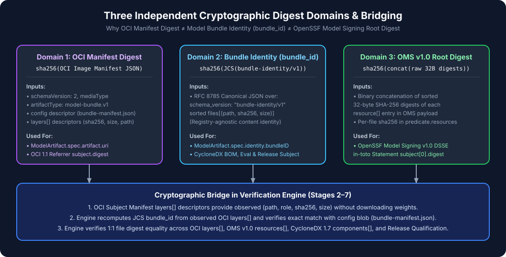

# Three-Domain Digest Model (`digest-model.md`)

A foundational requirement of `gke-model-admission-controller` ([ADR-002](../adr/ADR-002-oci-model-artifact.md)) is that **three distinct cryptographic digests** exist in the AI model supply chain, each computed over a different canonical input. They must never be treated as interchangeable strings, and the verification engine explicitly bridges them.

---

## 1. Mathematical Definition of the Three Digests

Let a model bundle consist of $N$ regular files sorted lexicographically by normalized relative path $p_i$, with raw byte content $B_i$, byte length $s_i = |B_i|$, file role $r_i$, and per-file SHA-256 digest:

$$d_i = \text{SHA256}(B_i)$$

### Digest 1: Model Bundle Identity (`bundle_id` — `bundle-identity/v1`)

Computed over the RFC 8785 JSON Canonicalization Scheme (JCS) serialization of the `bundle-identity/v1` file inventory structure:

$$\text{bundle\_id} = \text{SHA256}\Big(\text{JCS}\big(\{\text{"schema\_version"}: \text{"bundle-identity/v1"}, \text{"files"}: [(p_1, d_1, s_1), \dots, (p_N, d_N, s_N)]\}\big)\Big)$$

- **Property**: Registry-agnostic. Identical whether the model bundle lives on a local filesystem, in an object bucket, or in an OCI registry.
- **Where used**: `ModelArtifact.spec.identity.bundleID`, `bundle-manifest.json` (`bundle_id`), CycloneDX 1.7 root component hash, `evaluation-evidence/v1` in-toto `subject[0].digest`, and `release-qualification/v1` in-toto `subject[0].digest`.

### Digest 2: OpenSSF Model Signing Root Digest (`oms_root_digest` — OMS v1.0)

Computed by sorting the per-file resource entries and hashing the binary concatenation of their raw 32-byte SHA-256 digests:

$$\text{oms\_root\_digest} = \text{SHA256}\big(\text{raw\_bytes}(d_1) \parallel \text{raw\_bytes}(d_2) \parallel \dots \parallel \text{raw\_bytes}(d_N)\big)$$

- **Property**: Follows the OpenSSF Model Signing (`https://model_signing/signature/v1.0`) specification.
- **Where used**: `oms.sig.json` DSSE payload `subject[0].digest.sha256` alongside `predicate.resources[]` containing each $(p_i, d_i)$.

### Digest 3: OCI Subject Manifest Digest (`oci_manifest_digest` — OCI v1.1)

Computed over the raw JSON bytes of the OCI Distribution v1.1 Image Manifest (`application/vnd.oci.image.manifest.v1+json`):

$$\text{oci\_manifest\_digest} = \text{SHA256}(\text{raw OCI Subject Manifest JSON})$$

- **Property**: Registry-addressable. Binds the `config` blob descriptor (`bundle-manifest.json`), the `layers[]` descriptors (each carrying $d_i, s_i$ and annotations $p_i, r_i$), and the manifest annotations.
- **Where used**: `ModelArtifact.spec.artifact.uri` (`...@sha256:<64-hex>`), OCI v1.1 Referrer `subject.digest`, and `GET /v2/<repo>/referrers/<oci_manifest_digest>`.

---

## 2. How the Verification Engine Bridges All Three Digests

In [`internal/verification/verifier.go`](../../internal/verification/verifier.go):

1. **OCI -> Observed Descriptors (Stage 2)**: The controller fetches the OCI Subject Manifest by `oci_manifest_digest`, verifies `SHA256(rawManifestBytes) == oci_manifest_digest`, and extracts the observed file list $F_{\text{OCI}} = [(p_i, r_i, d_i, s_i)]$ from `manifest.layers[]`.
2. **Observed Descriptors -> `bundle_id` (Stage 3)**: The controller fetches the `config` blob (`bundle-manifest.json`) and calls `verify.VerifyBundleManifestBytes(rawConfigBlob, F_OCI, ...)`, which recomputes $\text{bundle\_id}$ via JCS directly from $F_{\text{OCI}}$ and verifies $\text{recomputed\_bundle\_id} == \text{bundle\_manifest.bundle\_id} == \text{ModelArtifact.spec.identity.bundleID}$.
3. **Observed Descriptors -> OMS v1.0 (Stage 4)**: The controller discovers the OMS referrer where `referrer.subject.digest == oci_manifest_digest` and calls `verify.VerifyOMSBytes(rawOMS, F_OCI, ...)`, which verifies that every file $(p_i, d_i)$ in $F_{\text{OCI}}$ matches `predicate.resources[]` and `oms_root_digest` 1:1.
4. **Observed Descriptors -> CycloneDX 1.7 BOM & Attestations (Stages 5–7)**: The controller verifies that the CycloneDX BOM, `evaluation-evidence/v1`, and `release-qualification/v1` referrers all bind to the exact same `bundle_id` and component digests.

---

## 3. Concrete Verified Example (from `examples/fixtures/minimal-safetensors`)

For the 6-file synthetic model bundle in [`examples/fixtures/minimal-safetensors/`](../../examples/fixtures/minimal-safetensors/):

- **`bundle-identity/v1` `bundle_id`**: `sha256:4ea48db6aa00c7908197674f0818f2c8a09821246ed021c8488ce84873cae97a`
- **CycloneDX 1.7 `bom.digest`**: `sha256:f8981ca6a2e0d2a8fc5abe4471991149c5f66748bbf4a9efef10f5dfde7400ac`
- Notice that `bundle_id` and `bom.digest` and the resulting `oci_manifest_digest` are three distinct 256-bit SHA-256 values—linked cryptographically through the verified file inventory $F_{\text{OCI}}$.
