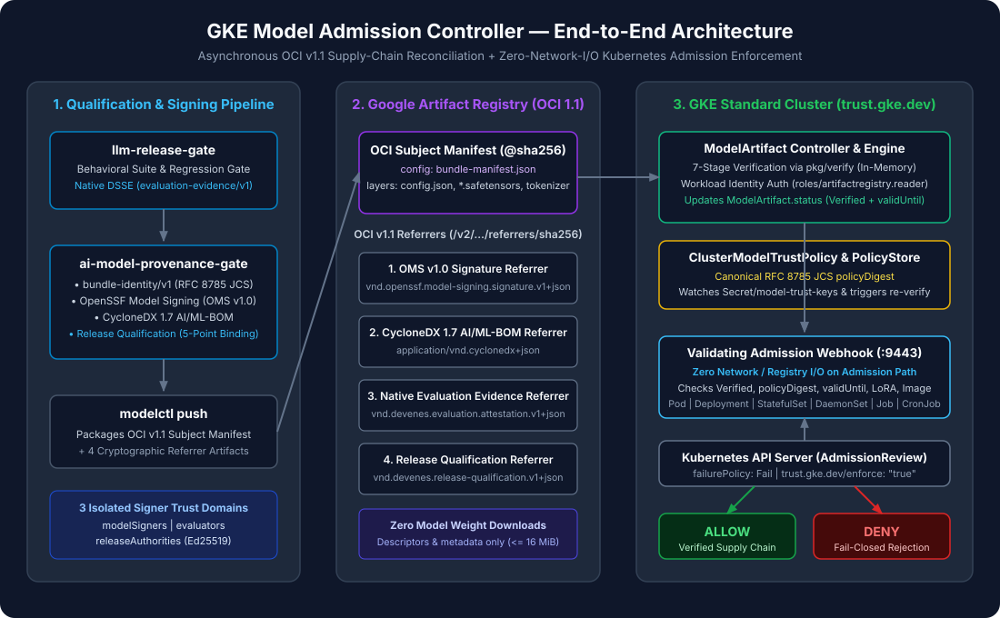

# Architecture Overview

**GKE Model Admission Controller** (`trust.gke.dev/v1alpha1`) is a Kubernetes security controller and `ValidatingAdmissionWebhook` for Google Kubernetes Engine (GKE). It bridges offline/CI model evaluation and cryptographic provenance with deployment-time Kubernetes admission control.

---

## 1. The Three-Repository Supply Chain

| Repository | Layer | Output Artifacts |
|---|---|---|
| [`llm-release-gate`](https://github.com/devenes/llm-release-gate) | Behavioral & Safety Evaluation | `report.json` (`llm-release-gate.report/v1`) and native DSSE evaluation attestation (`evaluation.dsse.json`, `evaluation-evidence/v1`, `binding_mode: "NATIVE_EVALUATOR"`). |
| [`ai-model-provenance-gate`](https://github.com/devenes/ai-model-provenance-gate) | Provenance, BOM, Signing, & Release Qualification | `bundle-manifest.json` (`bundle-identity/v1`), `oms.sig.json` (`openssf-model-signing/v1.0`), `bom.cdx.json` (CycloneDX 1.7), `attestation.json` (`release-qualification/v1`), and the public Go verification library `pkg/verify`. |
| [`gke-model-admission-controller`](https://github.com/devenes/gke-model-admission-controller) | OCI Publishing, GKE Reconciliation, & Admission Enforcement | OCI v1.1 Subject Manifest + 4 Referrers (`modelctl`), `ClusterModelTrustPolicy` & `ModelArtifact` reconcilers, and the zero-I/O `ValidatingAdmissionWebhook` (`manager`). |

---

## 2. Core Architectural Principles

1. **Asynchronous Verification vs. Synchronous Enforcement**:
   - [`ModelArtifactReconciler`](../../internal/controller/modelartifact_reconciler.go) performs all OCI v1.1 registry and Referrers API communication in the background and records the verification result in `ModelArtifact.status`.
   - [`WorkloadValidator`](../../internal/admission/validator.go) serves Kubernetes `AdmissionReview` requests in `<50ms` with **zero outbound network I/O**, evaluating only reconciled Kubernetes state (`ModelArtifact.status` and `PolicyStore`).
2. **Zero Model Weight Downloads**:
   - Model weight shards (`*.safetensors`) are verified via OCI manifest layer descriptors (`layers[].digest` and `layers[].size`) against `bundle-manifest.json`, OMS v1.0, and CycloneDX 1.7 BOM hashes.
   - [`Client.FetchMetadataBlob`](../../internal/registry/client.go) enforces a hard `16 MiB` limit (`MaxMetadataBlobBytes`) and refuses weight media types/roles.
3. **Fail-Closed Default-Deny**:
   - Namespaces labeled `trust.gke.dev/enforce: "true"` reject any `Pod`, `Deployment`, `StatefulSet`, `DaemonSet`, `Job`, or `CronJob` that lacks a valid, non-expired `ModelArtifact` reference matching the active `policyDigest`.

---

## Deep-Dive Architecture Documents

- [System Architecture](system-architecture.md)
- [Trust Model & Three Isolated Domains](trust-model.md)
- [End-to-End Data Flow](data-flow.md)
- [Three-Domain Digest Model](digest-model.md)
- [Admission Flow & Sequence](admission-flow.md)
- [Design Decisions & Trade-Offs](design-decisions.md)
