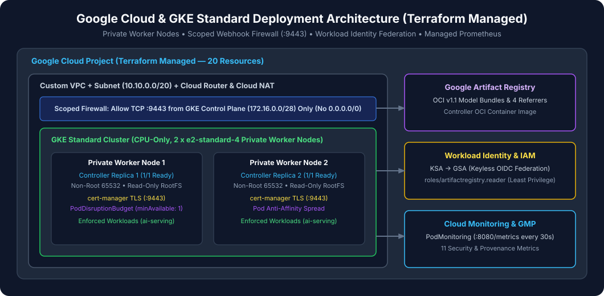

# System Architecture

This document describes the runtime components of `gke-model-admission-controller` inside a Google Kubernetes Engine (GKE) cluster and how they interact with Google Artifact Registry and the Kubernetes API server.

---

## 1. Control-Plane Components (`model-admission-system`)

All controller components run in the dedicated `model-admission-system` namespace inside a hardened distroless container (`runAsNonRoot: true`, `runAsUser: 65532`, `readOnlyRootFilesystem: true`, `capabilities.drop: ["ALL"]`):

1. **`ClusterModelTrustPolicyReconciler` ([`internal/controller/trustpolicy_reconciler.go`](../../internal/controller/trustpolicy_reconciler.go))**:
   - Watches `ClusterModelTrustPolicy` and referenced Kubernetes `Secret` objects (`model-trust-keys`).
   - Resolves Ed25519 public keys across `modelSigners`, `evaluators`, and `releaseAuthorities`, verifies SPKI `sha256:<64-hex>` fingerprints, and computes the canonical RFC 8785 JCS `policyDigest` ([`internal/policy/evaluator.go`](../../internal/policy/evaluator.go)).
   - Updates `PolicyStore` and triggers re-reconciliation of all `ModelArtifact` resources whenever `policyDigest` changes.
2. **`ModelArtifactReconciler` ([`internal/controller/modelartifact_reconciler.go`](../../internal/controller/modelartifact_reconciler.go))**:
   - Watches `ModelArtifact` resources with `GenerationChangedPredicate` (so status updates do not trigger self-reconcile loops).
   - Executes the 7-stage verification engine ([`internal/verification/verifier.go`](../../internal/verification/verifier.go)) against Google Artifact Registry using Workload Identity Federation.
   - Writes 7 structured status conditions (`ArtifactResolved`, `BundleIdentityVerified`, `OMSSignatureVerified`, `BOMVerified`, `EvaluationVerified`, `ReleaseQualificationPassed`, `Ready`), `status.verified`, `status.policyDigest`, and `status.validUntil` (`now + verificationTTLSeconds`), and requeues automatically before TTL expiry.
3. **`WorkloadValidator` Webhook Server ([`internal/admission/validator.go`](../../internal/admission/validator.go))**:
   - Serves HTTPS on port `9443` (`/validate-workloads`) using X.509 certificates managed by `cert-manager` (`Certificate/gke-model-admission-webhook-cert`).
   - Intercepts `CREATE` and `UPDATE` operations for `Pod`, `Deployment`, `StatefulSet`, `DaemonSet`, `Job`, and `CronJob` in namespaces labeled `trust.gke.dev/enforce: "true"`.
4. **Prometheus Metrics Server ([`internal/telemetry/metrics.go`](../../internal/telemetry/metrics.go))**:
   - Exposes 11 Prometheus metrics on `:8080/metrics`, scraped every `30s` by Google Cloud Managed Service for Prometheus via `PodMonitoring`.

---

## 2. High Availability & Leader Election

- **2 Replicas with Anti-Affinity**: The Helm chart schedules 2 replicas across separate worker nodes (`kubernetes.io/hostname` soft anti-affinity) protected by a `PodDisruptionBudget` (`minAvailable: 1`).
- **Active-Active Webhook Serving**: Both replicas serve `/validate-workloads` on `:9443` backed by their local informer caches.
- **Leader-Elected Reconciliation**: `--leader-elect=true` ensures only the active leader writes status updates to `ClusterModelTrustPolicy` and `ModelArtifact`.
