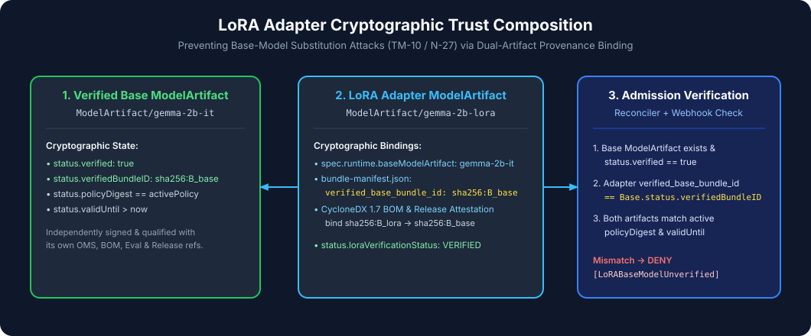

# LoRA Composition (`baseModelRef`)

Fine-tuned Low-Rank Adaptation (LoRA) weights are rarely deployed in isolation; at inference time, a serving runtime such as vLLM or TGI loads an immutable base foundation model alongside one or more adapter checkpoints. If an admission controller only verifies the adapter's signature without verifying the base model it targets—or vice versa—an attacker or misconfigured pipeline can pair a benign adapter with a compromised or unapproved base model.

**GKE Model Admission Controller** enforces **compositional trust** between a LoRA adapter and its base foundation model across three independent layers:

1. **Cryptographic Attestation Layer (`ReleaseQualificationPredicate.BaseModelBundleID`)**
2. **Reconciliation Graph Layer (`ModelArtifact.spec.baseModelRef` -> parent `ModelArtifact`)**
3. **Admission Webhook Layer (`internal/webhook/admission.go` parent state & identity binding)**



---

## 1. Cryptographic Attestation Layer

When an adapter bundle is qualified via `ai-model-provenance gate evaluate` (or packaged via `modelctl push --mode lora`), the signed `release-qualification/v1` in-toto statement (`predicateType: https://ai-model-provenance.io/attestation/release-qualification/v1`) records:

- **`predicate.bundleId`**: The deterministic `bundle-identity/v1` SHA-256 digest of the LoRA adapter bundle itself.
- **`predicate.baseModelBundleId`**: The deterministic `bundle-identity/v1` SHA-256 digest of the base foundation model against which the adapter was trained and evaluated.

Because `baseModelBundleId` is inside the DSSE-signed in-toto payload, changing which base model an adapter claims to target invalidates the release qualification signature (`RQ_SIGNATURE_INVALID` / `RQ_SUBJECT_MISMATCH`).

---

## 2. Kubernetes Reconciliation Layer (`internal/controller/modelartifact_controller.go`)

In Kubernetes, a LoRA adapter `ModelArtifact` declares its parent base model via `spec.baseModelRef`:

```yaml
apiVersion: trust.gke.dev/v1alpha1
kind: ModelArtifact
metadata:
  name: gemma-2b-lora
  namespace: ai-serving
spec:
  storageUri: oci://us-west4-docker.pkg.dev/PROJECT_ID/models/gemma-2b-lora@sha256:bbbbbbbbbbbbbbbbbbbbbbbbbbbbbbbbbbbbbbbbbbbbbbbbbbbbbbbbbbbbbbbb
  bundleIdentity: sha256:cccccccccccccccccccccccccccccccccccccccccccccccccccccccccccccccc
  modelFormat: safetensors
  runtimeClass: vllm
  baseModelRef:
    name: gemma-2b-it
```

When `ModelArtifactReconciler` reconciles `gemma-2b-lora`:

1. It resolves the OCI bundle for `gemma-2b-lora` and runs the 7-step `ai-model-provenance-gate/pkg/verify` cryptographic pipeline.
2. It looks up the referenced parent `ModelArtifact` (`gemma-2b-it`) in the **same namespace**.
   - If the parent `ModelArtifact` does not exist, reconciliation fails with reason `BASE_MODEL_NOT_FOUND`.
3. It checks the parent `ModelArtifact`'s status:
   - If `parent.Status.Phase != ModelArtifactPhaseVerified` or `parent.Status.ObservedGeneration != parent.Generation`, reconciliation fails with reason `BASE_MODEL_UNVERIFIED` (`"base model \"gemma-2b-it\" is not in Verified phase (current: Failed)"`).
4. It verifies cryptographic lineage binding (`internal/policy/evaluator.go` Rule 9):
   - If `ReleaseQualification.BaseModelBundleID != parent.Spec.BundleIdentity`, reconciliation fails with reason `LORA_BASE_MISMATCH`.

### Dynamic Re-Reconciliation via Field Indexer

What happens if the parent base model (`gemma-2b-it`) is modified or becomes `Failed` *after* the LoRA adapter (`gemma-2b-lora`) was already verified?

`ModelArtifactReconciler.SetupWithManager` registers a field index on `.spec.baseModelRef.name` and a ` builder.Watches` handler (`enqueueReferencingLoRAs`):

```go
mgr.GetFieldIndexer().IndexField(ctx, &trustv1alpha1.ModelArtifact{}, baseModelRefIndexField, func(rawObj client.Object) []string {
    ma := rawObj.(*trustv1alpha1.ModelArtifact)
    if ma.Spec.BaseModelRef == nil || ma.Spec.BaseModelRef.Name == "" {
        return nil
    }
    return []string{ma.Spec.BaseModelRef.Name}
})
```

Whenever `gemma-2b-it` changes state, `enqueueReferencingLoRAs` immediately enqueues every `ModelArtifact` in the namespace that references `gemma-2b-it`, re-evaluating their `Verified` status within milliseconds.

---

## 3. Synchronous Admission Webhook Layer (`internal/webhook/admission.go`)

To close any race window between a parent `ModelArtifact` edit and asynchronous controller reconciliation, the `ValidatingAdmissionWebhook` **also** inspects `spec.baseModelRef` synchronously on every Pod/Deployment admission request:

1. When a workload requests `trust.gke.dev/model-artifact: gemma-2b-lora`, the webhook fetches `ModelArtifact/gemma-2b-lora` and verifies its phase, `observedGeneration`, and `policyGeneration`.
2. Seeing `ma.Spec.BaseModelRef != nil`, the webhook synchronously fetches `ModelArtifact/gemma-2b-it` from the API server:
   - If `gemma-2b-it` is missing -> **DENY** (`BASE_MODEL_NOT_FOUND`).
   - If `gemma-2b-it` has `status.observedGeneration != metadata.generation` -> **DENY** (`BASE_MODEL_NOT_VERIFIED`).
   - If `gemma-2b-it` has `status.phase != Verified` -> **DENY** (`BASE_MODEL_NOT_VERIFIED`).
   - If `ma.Status.BaseModelBundleIdentity != ""` and does not match `baseMA.Spec.BundleIdentity` -> **DENY** (`LORA_BASE_MISMATCH`).

---

## Verified E2E Scenarios

| Scenario ID | Test Case | Expected Admission Result |
|---|---|---|
| **P-08** | Verified LoRA adapter (`gemma-2b-lora`) referencing Verified base model (`gemma-2b-it`) with matching `baseModelBundleId` | **ALLOWED** |
| **N-20** | LoRA adapter referencing a base model `ModelArtifact` that is in `Failed` phase | **DENIED (`BASE_MODEL_UNVERIFIED` / `BASE_MODEL_NOT_VERIFIED`)** |
| **N-21** | LoRA adapter whose signed attestation `baseModelBundleId` does not match the parent `ModelArtifact.spec.bundleIdentity` | **DENIED (`LORA_BASE_MISMATCH`)** |
