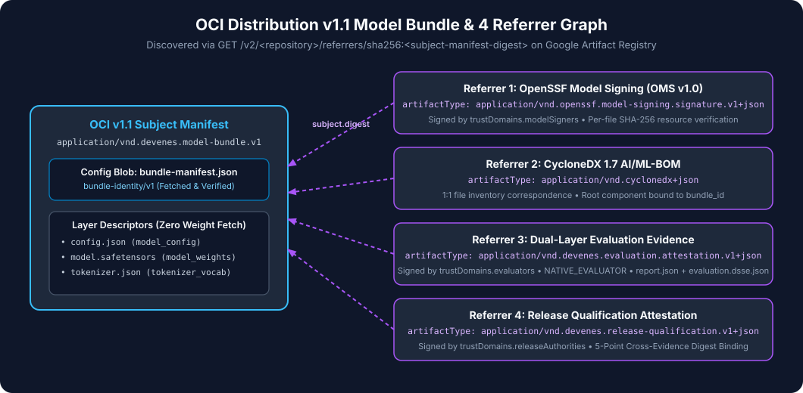

# Concept: OCI Distribution v1.1 Model Bundles & Referrers

`gke-model-admission-controller` stores both AI model bundles and their supply-chain evidence in standard **OCI Distribution v1.1** registries (such as Google Artifact Registry) using the native **OCI v1.1 Referrers API** ([ADR-002](../adr/ADR-002-oci-model-artifact.md)).



---

## 1. OCI Subject Manifest Layout (`application/vnd.devenes.model-bundle.v1`)

When `modelctl push` publishes a model bundle, it creates an OCI v1.1 Image Manifest (`application/vnd.oci.image.manifest.v1+json`) with:

- **`artifactType`**: `application/vnd.devenes.model-bundle.v1`
- **`config` descriptor**:
  - `mediaType`: `application/vnd.devenes.model-bundle.config.v1+json`
  - Contains the raw `bundle-manifest.json` (`bundle-identity/v1`) bytes.
- **`layers[]` descriptors**:
  - One layer per file in the model bundle (`config.json`, `model.safetensors`, `tokenizer.json`, etc.).
  - Each descriptor carries annotations:
    - `org.devenes.model.file.path`: Normalized relative path (e.g., `model.safetensors`).
    - `org.devenes.model.file.role`: File role (e.g., `model_weights`, `model_config`, `tokenizer_vocab`, `lora_weights`, `lora_config`).

---

## 2. The Four OCI v1.1 Referrer Artifacts

Each evidence artifact is pushed as its own OCI v1.1 Image Manifest with `subject` pointing to the Model Bundle Subject Manifest descriptor (`digest`, `size`, `mediaType`):

1. **OpenSSF Model Signing Referrer**:
   - `artifactType`: `application/vnd.openssf.model-signing.signature.v1+json`
   - Layer: `oms.sig.json` (`application/vnd.dsse.envelope.v1+json`)
2. **CycloneDX 1.7 AI/ML-BOM Referrer**:
   - `artifactType`: `application/vnd.cyclonedx+json`
   - Layer: `bom.cdx.json` (`application/vnd.cyclonedx+json`)
3. **Dual-Layer Behavioral Evaluation Referrer**:
   - `artifactType`: `application/vnd.devenes.evaluation.attestation.v1+json`
   - Layer 1: `evaluation.dsse.json` (`org.devenes.evidence.role: "evaluation-attestation"`)
   - Layer 2: `report.json` (`org.devenes.evidence.role: "evaluation-report"`)
4. **Release Qualification Referrer**:
   - `artifactType`: `application/vnd.devenes.release-qualification.v1+json`
   - Layer: `release-qualification.dsse.json` (`application/vnd.dsse.envelope.v1+json`)

---

## 3. Referrer Discovery & Cardinality Rules

The controller discovers referrers via:

```http
GET /v2/<repository>/referrers/sha256:<subject-manifest-digest>
Accept: application/vnd.oci.image.index.v1+json
```

For each required `artifactType`:

- If `ModelArtifact.spec.evidenceRefs` pins a specific referrer digest (e.g., `omsSignatureDigest`), the controller selects the exact matching descriptor.
- Otherwise, the controller requires **exactly 1** referrer of that `artifactType`. If `0` exist (`N-05`, `N-06`, `N-07`, `N-09`) or `>1` ambiguous referrers exist (`N-08`), reconciliation fails closed.
