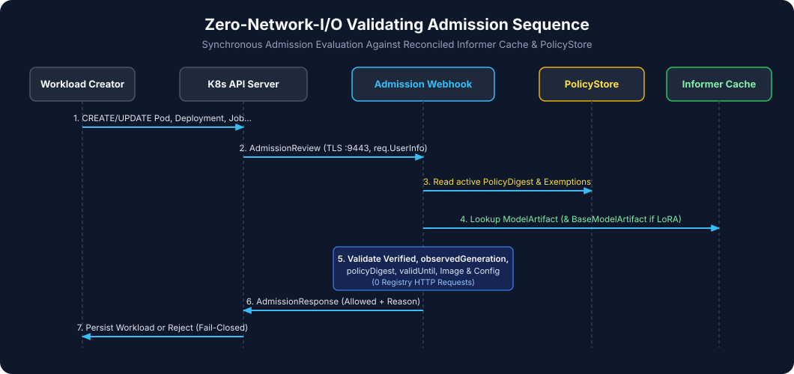

# Admission Enforcement Guide

The `ValidatingAdmissionWebhook` (`/validate-workloads` on TCP `9443`) intercepts `CREATE` and `UPDATE` operations in any namespace labeled with `model-admission.gke.io/enforce: "true"` (such as `ai-serving`).



---

## 1. Intercepted Kubernetes Workload Kinds

The webhook inspects the Pod spec (or PodTemplateSpec) of all 6 standard Kubernetes workload kinds:

1. **`Pod`** (`v1`)
2. **`Deployment`** (`apps/v1`)
3. **`StatefulSet`** (`apps/v1`)
4. **`DaemonSet`** (`apps/v1`)
5. **`Job`** (`batch/v1`)
6. **`CronJob`** (`batch/v1` — extracted from `spec.jobTemplate.spec.template`)

---

## 2. How Model-Serving Workloads Are Detected

Inside a protected namespace (`model-admission.gke.io/enforce: "true"`), the webhook classifies a workload as an AI model-serving workload if **any** of the following triggers match:

1. **Explicit Annotation**: `trust.gke.dev/model-artifact` is present on the workload or Pod template metadata.
2. **Model-Serving Labels**:
   - `ai.gke.io/model` is present, OR
   - `app.kubernetes.io/component` is `model-server`, `inference`, or `llm`.
3. **Container Heuristics (`isModelContainer`)**:
   - Container image contains `vllm`, `tgi`, `text-generation-inference`, `tritonserver`, or `ollama`, OR
   - Container args/command contain `--model` or `--model-id`, OR
   - Container mounts `/models` or `/mnt/models`.

### Default-Deny in Protected Namespaces (`MISSING_MODEL_ARTIFACT_REF`)

If a workload in a protected namespace triggers model-serving detection via labels or container heuristics (e.g., running `vllm` or passing `--model`), **omitting** `trust.gke.dev/model-artifact` does **not** bypass admission. Instead, the webhook rejects the workload with:

```text
[MISSING_MODEL_ARTIFACT_REF] workload in protected namespace runs a model-serving container or carries model labels without trust.gke.dev/model-artifact annotation
```

Non-model utility workloads (e.g. a plain `busybox` or `redis` pod with no model flags, mounts, or labels) are allowed without requiring a `ModelArtifact`.

---

## 3. Synchronous Admission Checks Executed on Every Request

When a workload declares `trust.gke.dev/model-artifact: <name>`, the webhook executes these checks in order:

| Step | Check | Denial Reason Code |
|---|---|---|
| 1 | `ClusterModelTrustPolicy/default` exists and is reconciled (`status.observedGeneration == generation`, `status.policyDigest != ""`) | `NO_TRUST_POLICY` / `POLICY_NOT_READY` |
| 2 | If `trust.gke.dev/exempt: "true"` is present, verify `req.UserInfo.Username` is in `spec.exemptions.allowedServiceAccounts` | `UNAUTHORIZED_EXEMPTION` |
| 3 | Referenced `ModelArtifact/<name>` exists in the **same** namespace (`req.Namespace`) | `MODEL_ARTIFACT_NOT_FOUND` |
| 4 | `ModelArtifact.status.observedGeneration == ModelArtifact.metadata.generation` | `GENERATION_UNOBSERVED` |
| 5 | `ModelArtifact.status.phase == Verified` | `MODEL_ARTIFACT_NOT_VERIFIED` |
| 6 | `ModelArtifact.status.policyGeneration == policy.Generation` and `status.evaluatedPolicyDigest == policy.Status.PolicyDigest` | `POLICY_GENERATION_STALE` / `POLICY_DIGEST_MISMATCH` |
| 7 | `time.Now().Before(ModelArtifact.status.validUntil)` | `ATTESTATION_EXPIRED` |
| 8 | If `ModelArtifact.spec.baseModelRef != nil`, fetch base `ModelArtifact` and verify `Verified` phase, `observedGeneration`, and `baseModelBundleIdentity == baseMA.spec.bundleIdentity` | `BASE_MODEL_NOT_FOUND` / `BASE_MODEL_NOT_VERIFIED` / `LORA_BASE_MISMATCH` |
| 9 | Every model-serving container (`initContainers`, `containers`, `ephemeralContainers`) uses an `@sha256:` digest-pinned image matching `ModelArtifact.spec.runtimeImage` and `allowedRuntimeImages` | `RUNTIME_IMAGE_NOT_DIGEST_PINNED` / `RUNTIME_IMAGE_MISMATCH` / `RUNTIME_IMAGE_FORBIDDEN` |
| 10 | If `requireServingConfigDigestMatch: true`, `trust.gke.dev/serving-config-digest` annotation must equal `ModelArtifact.spec.servingConfigDigest` | `SERVING_CONFIG_DIGEST_MISMATCH` |

---

## 4. Compliant Workload Example

```yaml
apiVersion: apps/v1
kind: Deployment
metadata:
  name: gemma-vllm-serving
  namespace: ai-serving
  annotations:
    trust.gke.dev/model-artifact: "gemma-2b-it"
    trust.gke.dev/serving-config-digest: "sha256:c1fb3dd4b72e479221aa59c0b5ff33d4eae61a14c2de7ffdd3a6cf57054f34b8"
spec:
  replicas: 1
  selector:
    matchLabels:
      app.kubernetes.io/name: gemma-vllm
      app.kubernetes.io/component: inference
  template:
    metadata:
      labels:
        app.kubernetes.io/name: gemma-vllm
        app.kubernetes.io/component: inference
      annotations:
        trust.gke.dev/model-artifact: "gemma-2b-it"
        trust.gke.dev/serving-config-digest: "sha256:c1fb3dd4b72e479221aa59c0b5ff33d4eae61a14c2de7ffdd3a6cf57054f34b8"
    spec:
      containers:
        - name: vllm
          image: us-west4-docker.pkg.dev/PROJECT_ID/models/vllm-runtime@sha256:1111111111111111111111111111111111111111111111111111111111111111
          args:
            - "--model=/models/gemma-2b-it"
```
