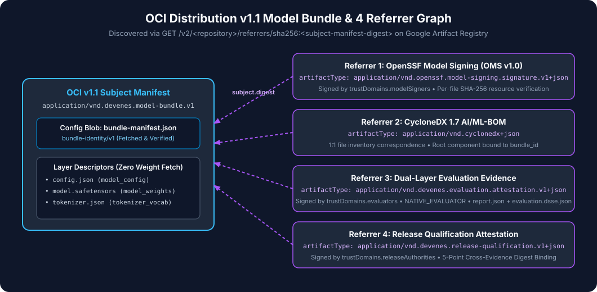

# Google Artifact Registry & OCI Packaging Guide

**GKE Model Admission Controller** uses Google Artifact Registry (Docker/OCI format) to store both the immutable model bundle and its four cryptographic evidence referrers.



---

## 1. Why OCI v1.1 + Referrers in Artifact Registry?

Google Artifact Registry (`format = "DOCKER"`) implements the **OCI Distribution Specification v1.1**, including:
- Arbitrary `artifactType` and layer `mediaType` values.
- The native **OCI Referrers API** (`GET /v2/<repo>/referrers/sha256:<digest>`) as well as the OCI Referrers tag schema (`sha256-<64-hex>`).
- Keyless authentication from GKE pods via **Workload Identity** (`roles/artifactregistry.reader`).

---

## 2. Authentication Setup

### Workstation Authentication (for `modelctl push` and `docker push`)

```bash
gcloud auth login
gcloud auth application-default login
gcloud auth configure-docker "${REGION}-docker.pkg.dev" --quiet
```

`modelctl` uses `github.com/google/go-containerregistry/pkg/authn.DefaultKeychain` paired with `google.Keychain`, so it automatically picks up your `gcloud` credentials or Application Default Credentials.

### In-Cluster Controller Authentication (Workload Identity)

Inside GKE, the controller pod runs as Kubernetes ServiceAccount `model-admission-system/model-admission-controller`, which is bound via Workload Identity to `gke-model-admission-ctrl@PROJECT_ID.iam.gserviceaccount.com`. No `imagePullSecrets` or static tokens are stored in Kubernetes Secrets.

---

## 3. Pushing Real Model Artifacts with `modelctl push`

Once you have generated your model bundle's cryptographic evidence using `ai-model-provenance` and `llm-release-gate`, push the bundle and all 4 OCI v1.1 evidence referrers to Artifact Registry:

```bash
./bin/modelctl push \
  --registry "${REGION}-docker.pkg.dev" \
  --repo "${PROJECT_ID}/models/gemma-2b-it" \
  --model-dir ./examples/fixtures/minimal-safetensors \
  --bundle-manifest /tmp/model-work/bundle-manifest.json \
  --oms-signature /tmp/model-work/oms.sig.json \
  --bom /tmp/model-work/bom.cdx.json \
  --eval-report /tmp/model-work/report.json \
  --eval-attestation /tmp/model-work/evaluation.dsse.json \
  --release-qualification /tmp/model-work/release-qualification.dsse.json \
  --out-model-artifact /tmp/model-work/modelartifact.yaml
```

### What `modelctl push` Uploads

1. **Model Bundle OCI Image Manifest (`application/vnd.devenes.ai-model-bundle.v1`)**:
   - `config`: `bundle-manifest.json` (`application/vnd.devenes.bundle-manifest.v1+json`)
   - `layers[]`: Raw model files (`config.json`, `model.safetensors`, `tokenizer.json`, etc.) with `org.opencontainers.image.title` set to the normalized relative path.
2. **4 OCI v1.1 Evidence Referrer Manifests** (each with `subject.digest` pointing to the Model Bundle Manifest's `sha256:...` digest):
   - `application/vnd.devenes.oms.signature.v1+json` (`oms.sig.json`)
   - `application/vnd.devenes.cyclonedx.mlbom.v1+json` (`bom.cdx.json`)
   - `application/vnd.devenes.evaluation.attestation.v1+json` (`evaluation.dsse.json` + `report.json`)
   - `application/vnd.devenes.release.qualification.v1+json` (`release-qualification.dsse.json`)

---

## 4. Inspecting Pushed Artifacts

List images and digests in Artifact Registry:

```bash
gcloud artifacts docker images list "${REGION}-docker.pkg.dev/${PROJECT_ID}/models" --include-tags
```
