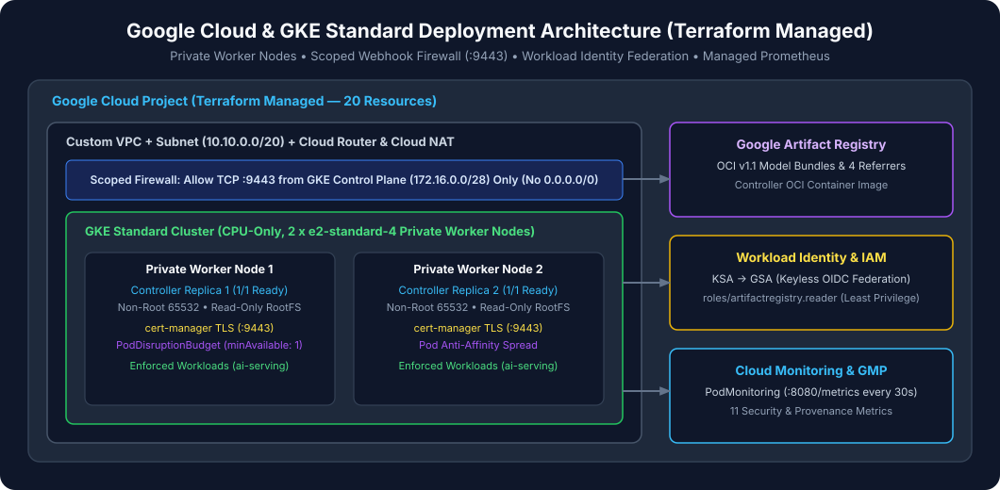

# GKE Deployment Guide

This guide walks through deploying **GKE Model Admission Controller** to a real Google Kubernetes Engine (GKE) cluster from scratch.



---

## 1. Configure Environment Variables

```bash
export PROJECT_ID="your-gcp-project-id"
export REGION="us-west4"
export ZONE="us-west4-a"
export CLUSTER_NAME="gke-model-admission-demo"
export ARTIFACT_REGISTRY="${REGION}-docker.pkg.dev/${PROJECT_ID}/models"
```

---

## 2. Provision Infrastructure with Terraform

All Google Cloud resources—VPC, Subnet, Firewall Rule (TCP `9443`), Artifact Registry, GKE Standard Zonal Cluster (`2 x e2-standard-2` CPU-only), Workload Identity IAM bindings, and Cloud Monitoring Dashboard—are managed by Terraform.

```bash
cp terraform/environments/demo/terraform.tfvars.example terraform/environments/demo/terraform.tfvars
# Edit terraform/environments/demo/terraform.tfvars and set project_id = "your-gcp-project-id"

terraform -chdir=terraform init
terraform -chdir=terraform plan -var-file=environments/demo/terraform.tfvars -out=tfplan
terraform -chdir=terraform apply tfplan
rm -f terraform/tfplan
```

---

## 3. Connect to GKE and Configure Registry Authentication

```bash
gcloud container clusters get-credentials "${CLUSTER_NAME}" \
  --zone "${ZONE}" \
  --project "${PROJECT_ID}"

gcloud auth configure-docker "${REGION}-docker.pkg.dev" --quiet
```

Verify cluster nodes:

```bash
kubectl get nodes -o wide
```

---

## 4. Install `cert-manager`

The controller relies on `cert-manager` to issue and automatically rotate the webhook TLS certificate (`model-admission-controller-webhook-tls`) and inject the CA bundle into the `ValidatingWebhookConfiguration`.

```bash
helm repo add jetstack https://charts.jetstack.io --force-update
helm upgrade --install cert-manager jetstack/cert-manager \
  --namespace cert-manager \
  --create-namespace \
  --version v1.17.1 \
  --set crds.enabled=true \
  --wait
```

---

## 5. Build, Push, and Digest-Pin the Controller Image

Build the multi-stage distroless `linux/amd64` container image from the workspace root (context is `..` so Go workspace sibling modules are included):

```bash
docker build --platform linux/amd64 \
  -t "${ARTIFACT_REGISTRY}/gke-model-admission-controller:v0.1.0" \
  -f Dockerfile ..

docker push "${ARTIFACT_REGISTRY}/gke-model-admission-controller:v0.1.0"

export IMAGE_DIGEST=$(gcloud artifacts docker images describe \
  "${ARTIFACT_REGISTRY}/gke-model-admission-controller:v0.1.0" \
  --format='value(image_summary.digest)')
echo "Pinned Controller Digest: ${IMAGE_DIGEST}"
```

---

## 6. Install the Controller Helm Chart

```bash
export GCP_SA="gke-model-admission-ctrl@${PROJECT_ID}.iam.gserviceaccount.com"

helm upgrade --install model-admission-controller ./charts/model-admission-controller \
  --namespace model-admission-system \
  --create-namespace \
  --set image.repository="${ARTIFACT_REGISTRY}/gke-model-admission-controller" \
  --set image.digest="${IMAGE_DIGEST}" \
  --set serviceAccount.annotations."iam\.gke\.io/gcp-service-account"="${GCP_SA}" \
  --wait
```

---

## 7. Verify Controller Health, TLS, and PDB

```bash
kubectl get pods -n model-admission-system -o wide
kubectl get certificate -n model-admission-system
kubectl get pdb -n model-admission-system
kubectl get validatingwebhookconfigurations model-admission-controller-webhook
```

Expected status:
- `2/2` controller pods `Running` with `0` restarts.
- `Certificate/model-admission-controller-webhook-tls` `READY = True`.
- `PodDisruptionBudget/model-admission-controller` `ALLOWED DISRUPTIONS = 1`.

---

## 8. Run the 42-Scenario Live GKE E2E Suite

```bash
make build
./bin/gke-e2e \
  --registry "${REGION}-docker.pkg.dev" \
  --repo-prefix "${PROJECT_ID}/models"
```

This pushes positive and negative OCI model bundles to Artifact Registry, configures `ClusterModelTrustPolicy/default`, reconciles `ModelArtifact` resources, and executes all 10 positive, 28 negative, and 4 resilience scenarios on the live GKE cluster.
