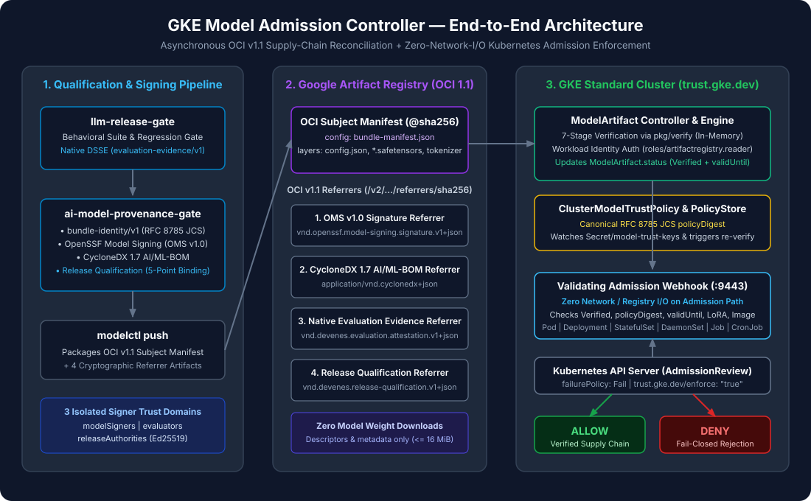

# Tutorial 01: Understanding AI Model Supply-Chain Admission Control

> **Series Navigation:** **01** → [02 Creating a Model Bundle](02-creating-a-model-bundle.md)

---

## 1. What you will learn

- Why traditional container image signing (`cosign` / Binary Authorization) does not protect AI model weights, tokenizers, or LoRA adapters loaded at runtime.
- How **llm-release-gate**, **ai-model-provenance-gate**, and **gke-model-admission-controller** form a unified 3-repository cryptographic trust chain.
- How the three distinct digest domains (`bundle-identity/v1`, OMS v1.0 root digest, and OCI v1.1 manifest digest) work together.
- How to build all three CLI binaries and inspect the synthetic model fixtures included in this repository.

---

## 2. Prerequisites

- Go `1.25.0+` installed (`go version`).
- All three sibling repositories cloned into the same parent workspace directory:
  - `../llm-release-gate`
  - `../ai-model-provenance-gate`
  - `./` (`gke-model-admission-controller`)
- See [Prerequisites Guide](../guides/prerequisites.md) for full details.

---

## 3. Architecture context



In Kubernetes AI serving stacks (vLLM, TGI, Triton), the container image is only the execution engine (`vllm-openai`). The actual intelligence—weights (`model.safetensors`), tokenizer (`tokenizer.json`), chat template (`chat_template.jinja`), and generation parameters (`generation_config.json`)—is loaded dynamically from an external artifact store.

**GKE Model Admission Controller** bridges this gap by enforcing that no AI inference workload can start in a protected GKE namespace unless its referenced `ModelArtifact` has passed a 7-step cryptographic verification pipeline without downloading multi-gigabyte weight blobs into the controller pod.

---

## 4. Required input files

This tutorial uses the self-contained synthetic model bundle included in the repository:

- [`examples/fixtures/minimal-safetensors/config.json`](../../examples/fixtures/minimal-safetensors/config.json)
- [`examples/fixtures/minimal-safetensors/special_tokens_map.json`](../../examples/fixtures/minimal-safetensors/special_tokens_map.json)
- [`examples/fixtures/minimal-safetensors/model.safetensors`](../../examples/fixtures/minimal-safetensors/model.safetensors)
- [`examples/fixtures/minimal-safetensors/tokenizer.json`](../../examples/fixtures/minimal-safetensors/tokenizer.json)
- [`examples/fixtures/minimal-safetensors/tokenizer_config.json`](../../examples/fixtures/minimal-safetensors/tokenizer_config.json)
- [`examples/fixtures/minimal-safetensors/chat_template.jinja`](../../examples/fixtures/minimal-safetensors/chat_template.jinja)

---

## 5. Step-by-step instructions

1. **Create a clean working directory** (`/tmp/model-work`) for tutorial artifacts and keys.
2. **Build all CLI and controller binaries** from the three repositories into `./bin/`.
3. **Generate the three isolated ECDSA P-256 keypairs** representing the three trust domains:
   - `model-signer` (Model Producer domain)
   - `eval-signer` (Trusted Behavioral Evaluator domain)
   - `release-signer` (Release Qualification Authority domain)
4. **Inspect the synthetic model fixture** directory structure.

---

## 6. Commands

```bash
# 1. Create working directories
mkdir -p /tmp/model-work/keys ./bin

# 2. Build controller, modelctl, and gke-e2e
make build

# 3. Build upstream CLI tools from sibling repositories
go build -C ../ai-model-provenance-gate -o ../gke-model-admission-controller/bin/ai-model-provenance ./cmd/ai-model-provenance
go build -C ../llm-release-gate -o ../gke-model-admission-controller/bin/llm-release-gate ./cmd/llm-release-gate

# 4. Generate 3 domain-isolated ECDSA P-256 keypairs
for role in model-signer eval-signer release-signer; do
  openssl ecparam -name prime256v1 -genkey -noout -out "/tmp/model-work/keys/${role}.PKCS1.key"
  openssl pkcs8 -topk8 -nocrypt -in "/tmp/model-work/keys/${role}.PKCS1.key" -out "/tmp/model-work/keys/${role}.key"
  openssl ec -in "/tmp/model-work/keys/${role}.key" -pubout -out "/tmp/model-work/keys/${role}.pub" 2>/dev/null
done

# 5. Inspect the synthetic safetensors model fixture
ls -lh examples/fixtures/minimal-safetensors/
```

---

## 7. Expected output

```text
mkdir -p bin
go build -o bin/controller ./cmd/controller
go build -o bin/modelctl ./cmd/modelctl
go build -o bin/gke-e2e ./cmd/gke-e2e
total 48
-rw-r--r--  1 user  staff    48B Nov  4 12:00 chat_template.jinja
-rw-r--r--  1 user  staff   202B Nov  4 12:00 config.json
-rw-r--r--  1 user  staff    85B Nov  4 12:00 generation_config.json
-rw-r--r--  1 user  staff   152B Nov  4 12:00 model.safetensors
-rw-r--r--  1 user  staff   111B Nov  4 12:00 tokenizer.json
-rw-r--r--  1 user  staff    94B Nov  4 12:00 tokenizer_config.json
```

---

## 8. How to verify success

Verify all five binaries exist in `./bin/` and the three keypairs exist in `/tmp/model-work/keys/`:

```bash
ls -1 ./bin/controller ./bin/modelctl ./bin/gke-e2e ./bin/ai-model-provenance ./bin/llm-release-gate
ls -1 /tmp/model-work/keys/*.pub /tmp/model-work/keys/*.key
```

---

## 9. Common errors

| Error | Cause | Fix |
|---|---|---|
| `go: directory ../ai-model-provenance-gate does not exist` | Sibling repositories are not cloned in `../` | Clone `ai-model-provenance-gate` and `llm-release-gate` alongside `gke-model-admission-controller` |
| `x509: failed to parse private key` | Key left in SEC1 (`EC PRIVATE KEY`) instead of PKCS#8 | Run the `openssl pkcs8 -topk8 -nocrypt` command shown in Step 4 |

---

## 10. Security considerations

- **Strict Trust Domain Separation**: Never reuse the same ECDSA keypair across `model-signer`, `eval-signer`, and `release-signer`. The controller passes keys from the other two domains as `UntrustedCandidates` (`pkg/verify`), so cross-domain key reuse is deterministically rejected as `UNTRUSTED_SIGNER`.
- **Never commit private keys**: Store private keys only in `/tmp/model-work/keys/` or a cloud KMS/secret manager; `.gitignore` blocks `*.key` and `*.pem` files from being committed.

---

## 11. What comes next

Proceed to **[Tutorial 02: Creating a Deterministic Model Bundle (`bundle-identity/v1`)](02-creating-a-model-bundle.md)** to inspect the model files and compute their RFC 8785 JCS content-addressed identity.
