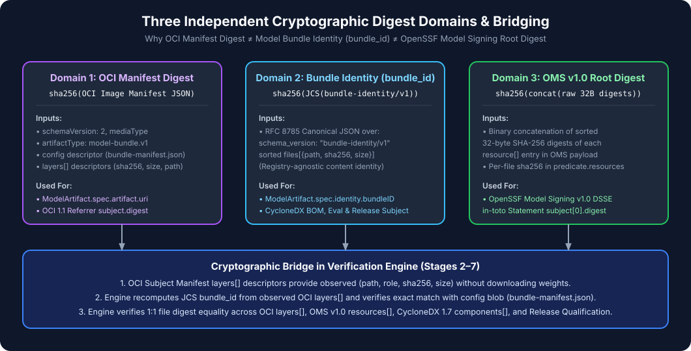

# Tutorial 02: Creating a Deterministic Model Bundle (`bundle-identity/v1`)

> **Series Navigation:** [01 Understanding AI Model Admission](01-understanding-ai-model-admission.md) ← **02** → [03 Generating a CycloneDX 1.7 AI/ML-BOM](03-generating-ai-ml-bom.md)

---

## 1. What you will learn

- How `bundle-identity/v1` computes a deterministic SHA-256 identity across all files in a model directory.
- How files are classified into roles (`weights_safetensors`, `model_config`, `generation_config`, `tokenizer`, `chat_template`) and checked for unsafe pickle payloads or remote code hooks.
- How RFC 8785 JSON Canonicalization Scheme (JCS) produces `bundle_id` and `manifest_digest`.

---

## 2. Prerequisites

- Completed [Tutorial 01](01-understanding-ai-model-admission.md) with `./bin/ai-model-provenance` built and `/tmp/model-work` created.

---

## 3. Architecture context



Every downstream artifact in the supply chain—the CycloneDX 1.7 BOM, the OpenSSF Model Signing envelope, the `llm-release-gate` evaluation attestation, the `release-qualification/v1` attestation, and the Kubernetes `ModelArtifact` resource—binds to `bundle_id` (`sha256:4ea48db6aa00c7908197674f0818f2c8a09821246ed021c8488ce84873cae97a` for our fixture).

---

## 4. Required input files

- [`examples/fixtures/minimal-safetensors/`](../../examples/fixtures/minimal-safetensors/) (6 files, 692 bytes total)

---

## 5. Step-by-step instructions

1. Run `./bin/ai-model-provenance inspect` against `./examples/fixtures/minimal-safetensors`.
2. Write the resulting `bundle-identity/v1` manifest to `/tmp/model-work/bundle-manifest.json`.
3. Inspect the generated JSON fields (`bundle_id`, `manifest_digest`, `primary_format`, `contains_unsafe_pickle`, `contains_remote_code_hooks`, and `files[]`).

---

## 6. Commands

```bash
./bin/ai-model-provenance inspect \
  --bundle ./examples/fixtures/minimal-safetensors \
  --output /tmp/model-work/bundle-manifest.json \
  --format json
```

---

## 7. Expected output

```json
{
  "bundle_id": "sha256:4ea48db6aa00c7908197674f0818f2c8a09821246ed021c8488ce84873cae97a",
  "contains_remote_code_hooks": false,
  "contains_symlinks": false,
  "contains_unsafe_pickle": false,
  "file_count": 6,
  "files": [
    {
      "path": "chat_template.jinja",
      "role": "chat_template",
      "sha256": "sha256:13bf8c426ca2489fd4fffa0e5bc7df8f2dfbd85b4402fb8bf114f417eb239930",
      "size": 48
    },
    {
      "path": "config.json",
      "role": "model_config",
      "sha256": "sha256:c17b249f036816fb195079d4b58784664e97c31b266304ebee1a85bb1788bf43",
      "size": 202
    },
    {
      "path": "generation_config.json",
      "role": "generation_config",
      "sha256": "sha256:1fa4111b40d97dc664fd923a9b355cf0fd2d5a4b897074bf228f168889079434",
      "size": 85
    },
    {
      "path": "model.safetensors",
      "role": "weights_safetensors",
      "sha256": "sha256:483fc5f77e1d5e19db5be49d2ddfb1bc4e3e6f67ffbe2d3c47ca11d11cf8a4cb",
      "size": 152
    },
    {
      "path": "tokenizer.json",
      "role": "tokenizer",
      "sha256": "sha256:1b4218a1dc7a7965810cb12ab272d4aa9bf25e79a26d09c44be6fb774e5e0ba5",
      "size": 111
    },
    {
      "path": "tokenizer_config.json",
      "role": "tokenizer",
      "sha256": "sha256:7cd43c3bdcf71fa1ae1f11d8a812ae0fd6a1647ebba79c3f1616b80d8da5f286",
      "size": 94
    }
  ],
  "has_lora_adapter": false,
  "lora_verification_status": "NOT_APPLICABLE",
  "manifest_digest": "sha256:bc81c85d1cf6be299d295c9145a9e95a3cb05fc353349f8961cd812d93bd6314",
  "primary_format": "safetensors",
  "schema_version": "bundle-identity/v1",
  "total_bytes": 692
}
```

---

## 8. How to verify success

Check that `bundle_id` equals the deterministic SHA-256 value:

```bash
jq -r '.bundle_id' /tmp/model-work/bundle-manifest.json
# Expected: sha256:4ea48db6aa00c7908197674f0818f2c8a09821246ed021c8488ce84873cae97a
```

---

## 9. Common errors

| Error | Cause | Fix |
|---|---|---|
| `BUNDLE_UNKNOWN_FILES_FORBIDDEN` | Writing `bundle-manifest.json` *inside* `./examples/fixtures/minimal-safetensors/` | Always write `bundle-manifest.json` outside the model directory (e.g. `/tmp/model-work/bundle-manifest.json`) to avoid the self-hashing paradox |

---

## 10. Security considerations

- **No Hidden Execution Hooks**: `ai-model-provenance inspect` parses `config.json` and scans file extensions to set `contains_unsafe_pickle` and `contains_remote_code_hooks`.
- **Self-Hashing Prevention (ADR-002)**: When packaged into OCI, `bundle-manifest.json` is stored in the OCI manifest `config` slot—never as a model file layer—so recomputing `bundle-identity/v1` from OCI `layers[]` descriptors produces the exact same `bundle_id`.

---

## 11. What comes next

Proceed to **[Tutorial 03: Generating a CycloneDX 1.7 AI/ML-BOM](03-generating-ai-ml-bom.md)** to generate and validate the CycloneDX 1.7 Bill of Materials for this bundle.
