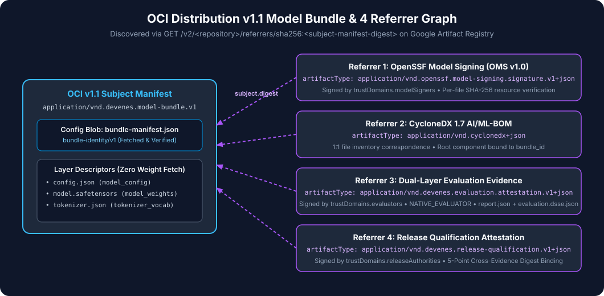

# Tutorial 07: Publishing the OCI Model Bundle and Evidence Referrers (`modelctl push`)

> **Series Navigation:** [06 Creating Release Qualification Attestation](06-creating-release-qualification-attestation.md) ← **07** → [08 Provisioning GKE with Terraform](08-provisioning-gke-with-terraform.md)

---

## 1. What you will learn

- How `modelctl push` packages raw model files into an OCI v1.1 Image Manifest (`application/vnd.devenes.ai-model-bundle.v1`) with `bundle-manifest.json` as the OCI `config` blob.
- How `modelctl push` attaches the 4 cryptographic evidence artifacts as OCI v1.1 Referrers (`subject.digest == <model-manifest-digest>`).
- How to test `modelctl push` against either a local ephemeral OCI v1.1 registry or Google Artifact Registry.

---

## 2. Prerequisites

- Completed [Tutorials 01–06](06-creating-release-qualification-attestation.md) with all evidence files in `/tmp/model-work/`.
- If pushing to Google Artifact Registry: `gcloud auth configure-docker "${REGION}-docker.pkg.dev"`.

---

## 3. Architecture context



`modelctl push` implements **ADR-002**:
1. Each file in `./examples/fixtures/minimal-safetensors` is uploaded as an uncompressed raw layer (`application/vnd.devenes.model-file.v1+octet-stream`) carrying `org.opencontainers.image.title: <relative-path>`.
2. `bundle-manifest.json` is uploaded as the OCI `config` blob (`application/vnd.devenes.bundle-manifest.v1+json`).
3. The 4 evidence artifacts (`oms.sig.json`, `bom.cdx.json`, `evaluation.dsse.json` + `report.json`, and `release-qualification.dsse.json`) are pushed as OCI v1.1 Referrer manifests with `subject` pointing to the immutable model manifest digest.

---

## 4. Required input files

- `./examples/fixtures/minimal-safetensors/`
- `/tmp/model-work/bundle-manifest.json`
- `/tmp/model-work/oms.sig.json`
- `/tmp/model-work/bom.cdx.json`
- `/tmp/model-work/report.json`
- `/tmp/model-work/evaluation.dsse.json`
- `/tmp/model-work/release-qualification.dsse.json`

---

## 5. Step-by-step instructions

1. Set your target registry (`${REGION}-docker.pkg.dev`) and repository (`${PROJECT_ID}/models/gemma-2b-it`).
2. Run `./bin/modelctl push` with the explicit artifact flags from `/tmp/model-work/`.
3. Inspect the generated `/tmp/model-work/modelartifact.yaml` manifest containing the resolved `@sha256:<manifest-digest>` and `bundleIdentity`.

---

## 6. Commands

```bash
export REGION="${REGION:-us-west4}"
export PROJECT_ID="${PROJECT_ID:-your-gcp-project-id}"

./bin/modelctl push \
  --registry "${REGION}-docker.pkg.dev" \
  --repo "${PROJECT_ID}/models/gemma-2b-it" \
  --name gemma-2b-it \
  --namespace ai-serving \
  --model-dir ./examples/fixtures/minimal-safetensors \
  --bundle-manifest /tmp/model-work/bundle-manifest.json \
  --oms-signature /tmp/model-work/oms.sig.json \
  --bom /tmp/model-work/bom.cdx.json \
  --eval-report /tmp/model-work/report.json \
  --eval-attestation /tmp/model-work/evaluation.dsse.json \
  --release-qualification /tmp/model-work/release-qualification.dsse.json \
  --runtime-image "us-west4-docker.pkg.dev/${PROJECT_ID}/models/vllm-runtime@sha256:1111111111111111111111111111111111111111111111111111111111111111" \
  --serving-config-digest "sha256:c1fb3dd4b72e479221aa59c0b5ff33d4eae61a14c2de7ffdd3a6cf57054f34b8" \
  --out-model-artifact /tmp/model-work/modelartifact.yaml
```

> **Tip: Quick Synthetic Push Mode**
> If you want `modelctl` to generate fresh keys, synthetic model files, all 4 evidence artifacts, `ClusterModelTrustPolicy`, and `ModelArtifact` in a single command, you can also run:
> ```bash
> ./bin/modelctl push \
>   --registry "${REGION}-docker.pkg.dev" \
>   --repo "${PROJECT_ID}/models/gemma-2b-it" \
>   --out-policy /tmp/model-work/policy-crd.yaml \
>   --out-model-artifact /tmp/model-work/modelartifact.yaml
> ```

---

## 7. Expected output

```text
Model Bundle pushed successfully!
  Storage URI:         oci://us-west4-docker.pkg.dev/PROJECT_ID/models/gemma-2b-it@sha256:6267e4f82361f0de6fe473de80ab6db8ff42ff73ba8f5c11a4f788bf375c39c6
  OCI Manifest Digest: sha256:6267e4f82361f0de6fe473de80ab6db8ff42ff73ba8f5c11a4f788bf375c39c6
  Bundle Identity:     sha256:4ea48db6aa00c7908197674f0818f2c8a09821246ed021c8488ce84873cae97a
  Runtime Image:       us-west4-docker.pkg.dev/PROJECT_ID/models/vllm-runtime@sha256:1111111111111111111111111111111111111111111111111111111111111111
  Serving Config Hash: sha256:c1fb3dd4b72e479221aa59c0b5ff33d4eae61a14c2de7ffdd3a6cf57054f34b8
Wrote ModelArtifact YAML to /tmp/model-work/modelartifact.yaml
```

---

## 8. How to verify success

Inspect `/tmp/model-work/modelartifact.yaml` and verify that `spec.storageUri` is pinned with `@sha256:` and `spec.bundleIdentity` matches `bundle-manifest.json`:

```bash
cat /tmp/model-work/modelartifact.yaml
```

---

## 9. Common errors

| Error | Cause | Fix |
|---|---|---|
| `DENIED: Permission "artifactregistry.repositories.uploadArtifacts" denied` | Missing Docker credential helper or IAM permissions on Artifact Registry | Run `gcloud auth configure-docker "${REGION}-docker.pkg.dev"` |
| `failed to read bundle-manifest` | Incomplete explicit file flags | When passing `--model-dir`, provide all 6 evidence file flags (`--bundle-manifest`, `--oms-signature`, `--bom`, `--eval-report`, `--eval-attestation`, `--release-qualification`) |

---

## 10. Security considerations

- **Immutable Digest Addressing**: `modelctl push` outputs the `@sha256:<64-hex>` OCI manifest digest (`spec.storageUri`). Even if someone later overwrites the `:v1.0.0` tag in Artifact Registry, the `ModelArtifact` remains cryptographically bound to the exact immutable OCI manifest digest.

---

## 11. What comes next

Proceed to **[Tutorial 08: Provisioning the CPU-Only GKE Cluster & Artifact Registry with Terraform](08-provisioning-gke-with-terraform.md)**.
