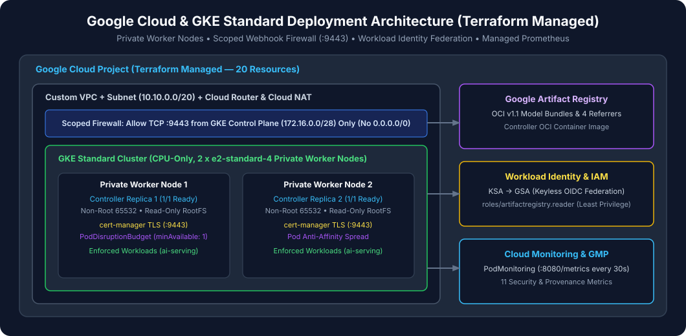

# Tutorial 08: Provisioning GKE & Artifact Registry with Terraform

> **Series Navigation:** [07 Publishing to Artifact Registry](07-publishing-to-artifact-registry.md) ← **08** → [09 Installing the Admission Controller](09-installing-the-admission-controller.md)

---

## 1. What you will learn

- How the repository's Terraform configuration ([`terraform/`](../../terraform/)) provisions a CPU-only 2-node Standard Zonal GKE cluster (`e2-standard-2`), VPC, subnet, webhook firewall rule (`tcp:9443`), Artifact Registry (`models`), Workload Identity IAM bindings, and Cloud Monitoring dashboard.
- How to validate, plan, and apply the infrastructure safely.

---

## 2. Prerequisites

- Terraform `1.6.0+` and `gcloud` CLI installed and authenticated (`gcloud auth application-default login`).
- A Google Cloud Project with billing enabled (`export PROJECT_ID="your-gcp-project-id"`).

---

## 3. Architecture context



All Google Cloud resources are managed strictly through Terraform:
- **GKE Cluster (`gke-model-admission-demo`)**: Zonal Standard cluster in `us-west4-a` with Workload Identity (`PROJECT_ID.svc.id.goog`) and `2 x e2-standard-2` CPU-only nodes.
- **Webhook Firewall (`allow-gke-master-to-webhook-9443`)**: Allows the GKE API server (`172.16.0.0/28`) to reach the controller's `ValidatingAdmissionWebhook` on TCP `9443`.
- **Workload Identity IAM (`gke-model-admission-ctrl`)**: Grants `roles/artifactregistry.reader` on the `models` repository to the Kubernetes ServiceAccount `model-admission-system/model-admission-controller`.

---

## 4. Required input files

- [`terraform/versions.tf`](../../terraform/versions.tf)
- [`terraform/providers.tf`](../../terraform/providers.tf)
- [`terraform/variables.tf`](../../terraform/variables.tf)
- [`terraform/main.tf`](../../terraform/main.tf)
- [`terraform/outputs.tf`](../../terraform/outputs.tf)
- [`terraform/environments/demo/terraform.tfvars.example`](../../terraform/environments/demo/terraform.tfvars.example)

---

## 5. Step-by-step instructions

1. Copy `terraform/environments/demo/terraform.tfvars.example` to `terraform/environments/demo/terraform.tfvars` and set your `project_id`.
2. Run `terraform init`, `terraform fmt -check`, and `terraform validate`.
3. Generate and inspect the execution plan (`terraform plan`).
4. Apply the plan (`terraform apply`) and fetch GKE cluster credentials (`gcloud container clusters get-credentials`).

---

## 6. Commands

```bash
export PROJECT_ID="your-gcp-project-id"
export REGION="us-west4"
export ZONE="us-west4-a"
export CLUSTER_NAME="gke-model-admission-demo"

# 1. Create terraform.tfvars from the example template
cp terraform/environments/demo/terraform.tfvars.example terraform/environments/demo/terraform.tfvars
sed -i.bak "s/PROJECT_ID/${PROJECT_ID}/g" terraform/environments/demo/terraform.tfvars && rm -f terraform/environments/demo/terraform.tfvars.bak

# 2. Initialize and validate Terraform
terraform -chdir=terraform init
terraform -chdir=terraform fmt -check -recursive
terraform -chdir=terraform validate

# 3. Review and apply the Terraform plan
terraform -chdir=terraform plan -var-file=environments/demo/terraform.tfvars -out=tfplan
terraform -chdir=terraform apply tfplan
rm -f terraform/tfplan

# 4. Connect kubectl to the GKE cluster
gcloud container clusters get-credentials "${CLUSTER_NAME}" \
  --zone "${ZONE}" \
  --project "${PROJECT_ID}"
```

---

## 7. Expected output

```text
Apply complete! Resources: 19 added, 0 changed, 0 destroyed.

Outputs:

artifact_registry_url = "us-west4-docker.pkg.dev/PROJECT_ID/models"
cluster_name = "gke-model-admission-demo"
controller_gsa_email = "gke-model-admission-ctrl@PROJECT_ID.iam.gserviceaccount.com"
get_credentials_command = "gcloud container clusters get-credentials gke-model-admission-demo --zone us-west4-a --project PROJECT_ID"
```

---

## 8. How to verify success

Verify the two CPU-only nodes are `Ready` and Workload Identity is active:

```bash
kubectl get nodes -o wide
gcloud container clusters describe "${CLUSTER_NAME}" --zone "${ZONE}" --project "${PROJECT_ID}" \
  --format='value(workloadIdentityConfig.workloadPool)'
```

---

## 9. Common errors

| Error | Cause | Fix |
|---|---|---|
| `Error 403: Compute Engine API has not been used` | First-time API activation propagation delay | Re-run `terraform apply`; `apis.tf` enables all 8 required APIs |
| `Error: Insufficient regional quota` | Region has `< 4` CPUs available | Override `region` and `zone` in `terraform.tfvars` |

---

## 10. Security considerations

- **Least-Privilege Service Accounts**: Neither the GKE node ServiceAccount (`gke-nodes`) nor the controller ServiceAccount (`gke-model-admission-ctrl`) uses the default Compute Engine service account or broad `Editor` roles.
- **Never commit `terraform.tfstate` or `tfplan`**: `.gitignore` excludes all `.tfstate`, `.tfvars` (except `.tfvars.example`), and `tfplan` files.

---

## 11. What comes next

Proceed to **[Tutorial 09: Installing `cert-manager` and the Admission Controller via Helm](09-installing-the-admission-controller.md)**.
