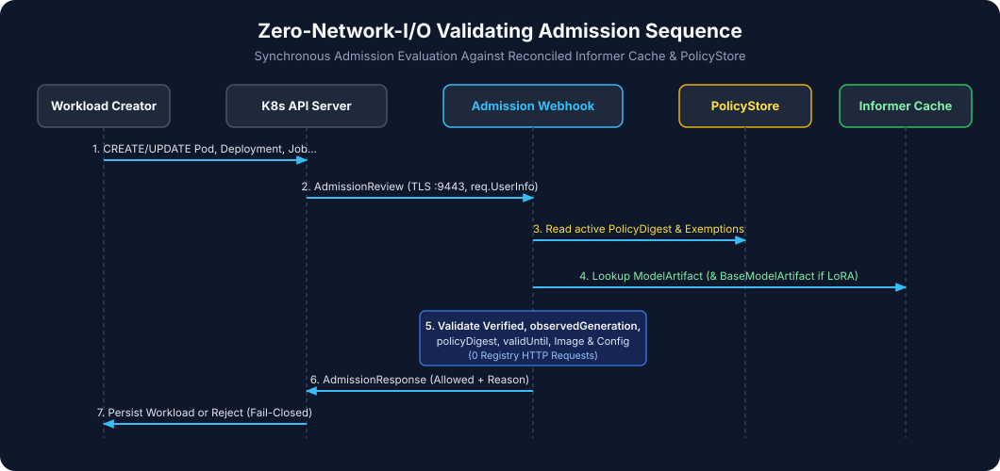

# Tutorial 12: Deploying an Approved AI Inference Workload (`P-01` – `P-10`)

> **Series Navigation:** [11 Registering a ModelArtifact](11-registering-a-modelartifact.md) ← **12** → [13 Testing Security Failures](13-testing-security-failures.md)

---

## 1. What you will learn

- How to deploy a compliant AI model-serving `Deployment` (as well as `StatefulSet`, `DaemonSet`, `Job`, `CronJob`, and `Pod`) in the protected `ai-serving` namespace.
- How the `ValidatingAdmissionWebhook` synchronously validates the `ModelArtifact` reference, `policyDigest`, `validUntil`, `@sha256:` runtime image digest, and `serving-config-digest`.

---

## 2. Prerequisites

- Completed [Tutorial 11](11-registering-a-modelartifact.md) with `ModelArtifact/gemma-2b-it` in `Verified` phase in namespace `ai-serving`.

---

## 3. Architecture context



When a `Deployment` is submitted to `ai-serving` (`model-admission.gke.io/enforce: "true"`), the Kubernetes API server calls `https://model-admission-controller-webhook.model-admission-system.svc:443/validate-workloads`. Both the `Deployment` admission request and the downstream `Pod` admission request are verified against `ModelArtifact/gemma-2b-it`.

---

## 4. Required input files

- [`examples/positive-deployment.yaml`](../../examples/positive-deployment.yaml)

---

## 5. Step-by-step instructions

1. Render `/tmp/model-work/positive-deployment.yaml` from [`examples/positive-deployment.yaml`](../../examples/positive-deployment.yaml) with your `PROJECT_ID`.
2. Apply `/tmp/model-work/positive-deployment.yaml` (or validate with `--dry-run=server` if you do not have a real `vllm-runtime` container image pushed yet).
3. Inspect the admission controller logs and Prometheus metrics confirming `decision="allow", reason="VERIFIED"`.

---

## 6. Commands

```bash
export PROJECT_ID="${PROJECT_ID:-your-gcp-project-id}"
sed "s/PROJECT_ID/${PROJECT_ID}/g" examples/positive-deployment.yaml > /tmp/model-work/positive-deployment.yaml

# Validate admission approval via the live GKE ValidatingAdmissionWebhook
kubectl apply --dry-run=server -f /tmp/model-work/positive-deployment.yaml
```

---

## 7. Expected output

```text
deployment.apps/gemma-vllm-serving created (server dry run)
```

---

## 8. How to verify success

Check the controller logs in `model-admission-system` to see the structured admission approval record:

```bash
kubectl logs -n model-admission-system -l app.kubernetes.io/name=model-admission-controller --tail=20
```

---

## 9. Common errors

| Error | Cause | Fix |
|---|---|---|
| `[RUNTIME_IMAGE_MISMATCH]` | Container image in `positive-deployment.yaml` differs from `ModelArtifact.spec.runtimeImage` | Ensure the container `image:` matches `ModelArtifact.spec.runtimeImage` (`...@sha256:1111...`) |
| `[SERVING_CONFIG_DIGEST_MISMATCH]` | Missing or mismatched `trust.gke.dev/serving-config-digest` annotation | Set `trust.gke.dev/serving-config-digest: "sha256:c1fb3dd4b72e479221aa59c0b5ff33d4eae61a14c2de7ffdd3a6cf57054f34b8"` |

---

## 10. Security considerations

- **All 6 Workload Kinds Covered**: In addition to `Deployment` (`P-01`), the webhook enforces the exact same checks on direct `Pod` (`P-02`), `StatefulSet` (`P-03`), `DaemonSet` (`P-04`), `Job` (`P-05`), and `CronJob` (`P-06`), while allowing non-model utility workloads (`P-07`) and Verified LoRA compositions (`P-08`).

---

## 11. What comes next

Proceed to **[Tutorial 13: Testing Adversarial Security Failures & Attack Scenarios (`N-01` – `N-28`)](13-testing-security-failures.md)** to see how the controller blocks tampered weights, cross-domain key misuse, mutable tags, unannotated model pods, and unauthorized exemptions.
